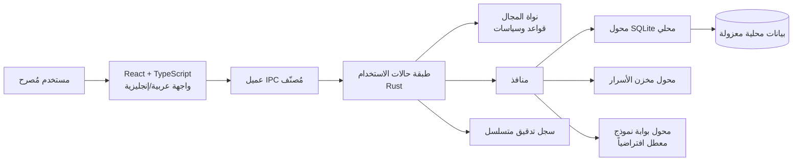
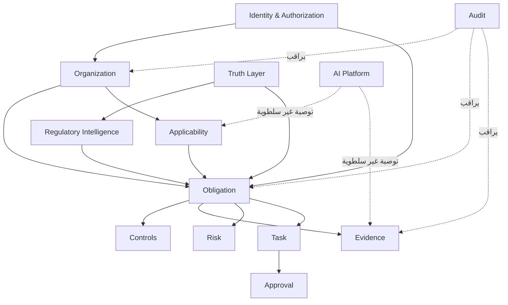
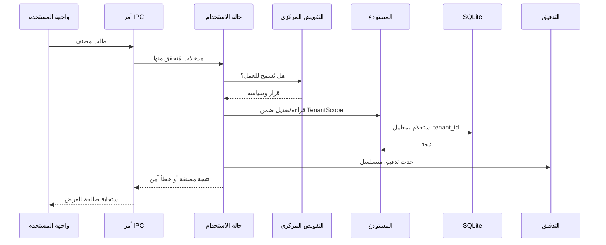

# خط الأساس المعماري — NEXUS

**الإصدار:** 0.1.0  
**الحالة:** مقترح مُعتمد للتأسيس  
**النطاق:** MVP محلي أولاً، ثنائي اللغة، لا يدّعي تغطية تنظيمية رسمية أو جاهزية إنتاجية.

## 1. الغاية والحدود

NEXUS هو نظام تشغيل للالتزامات التنظيمية يجيب عن: ما الذي يجب فعله، ولماذا، ومتى، ومن المالك، وما الدليل، وما الذي تغيّر. لا يحل محل المستشار القانوني ولا يصرح بالامتثال القانوني. كل نتيجة منظمة يجب أن تحمل مصدرها وحالة تحققها ودرجة ثقتها.

ينفذ هذا الإصدار العملي تدفقاً حقيقياً داخل جهاز واحد: مؤسسة تجريبية موسومة، التزامات مصدرها بيانات تركيبية، قابلية انطباق قابلة للمراجعة، أدلة مرتبطة، مخاطر، مهام، موافقات، سجلات تدقيق، وتقارير محلية. تظل وظائف مزودات الذكاء والسحب والاستيراد التنظيمي الخارجي معطلة بوضوح حتى تهيئتها والتحقق منها.

## 2. مبادئ ملزمة

| المبدأ | تطبيقه في MVP |
|---|---|
| Clean Architecture | واجهة العرض تستدعي حالات استخدام عبر عميل IPC فقط؛ المجال لا يستورد Tauri أو SQLite أو React. |
| DDD وحدود صريحة | المجالات الأولية: Organization, Identity, Authorization, Obligation, Evidence, Risk, Task, Approval, Audit, Truth. |
| Local-first | قاعدة SQLite في مجلد بيانات التطبيق، مهاجرات مرقمة، ولا تعتمد الشاشة على اتصال شبكي. |
| انعدام الثقة | لا توجد أوامر نظام عامة أو وصول ملفات عام، وكل أمر IPC محدد ومدقق. |
| مصدر الحقيقة | الادعاءات والالتزامات تحفظ مع النوع والمصدر والإصدار والثقة وحالة التحقق. |
| الإنسان في التحكم | القرارات ذات الأثر العالي لا تنفذ تلقائياً؛ تنتقل إلى موافقة قابلة للتدقيق. |
| عزل المستأجر | كل سجلات الأعمال تحمل `tenant_id`، وكل استعلام يخضع له داخل طبقة المستودع. |
| قابلية التتبع | يولد كل تغيير تدقيقاً append-only بسلسلة تجزئة محلية. |
| لغة ثنائية | كل نص واجهة موجود في موارد ترجمة عربية وإنجليزية؛ اتجاه الصفحة يحدد من اللغة. |

## 3. السياق المعماري

## 4. طبقات التطبيق

| الطبقة | المسؤوليات | القيود |
|---|---|---|
| Presentation | React، التنقل، التوطين، الحالة العابرة، التحقق المبدئي وإتاحة الاستخدام | لا SQL، لا مفاتيح، لا قواعد مجال حاسمة، لا وصول نظام. |
| Application | حالات الاستخدام، المعاملات، التفويض، التحقق، النشر للتدقيق، توحيد الأخطاء | لا تعتمد على React أو SQL أو مزود AI بعينه. |
| Domain | الكيانات، القيم، السياسات، الحالات، أحداث المجال | لا تعتمد على Tauri أو قاعدة بيانات أو شبكة. |
| Infrastructure | Tauri IPC، SQLite، Stronghold، التخزين، موصلات AI، الوقت والمعرفات | تطبق منافذ الطبقة التطبيقية فقط. |

## 5. خريطة المجالات الأولية

### تعريف الحدود

| المجال | مسؤوليته | غير مسؤول عنه |
|---|---|---|
| Organization | الملف والقطاعات والأقسام والفروع والنشاطات | تحديد الالتزام التنظيمي النهائي. |
| Regulatory Intelligence | المصدر والمستند والإصدار والمتطلب والتغيير | تمثيل قانوني أو جلب مصدر غير محقق. |
| Obligation | الالتزام والمالك والموعد والحالة والارتباطات | تخزين الدليل الخام. |
| Evidence | الدليل والتصنيف والتجزئة والإصدار والتحقق | تقرير الانطباق دون سياسة. |
| Risk | مستوى التأثير والاحتمال والتعرض والمعالجة | تعديل الالتزامات مباشرة. |
| Task & Approval | تنفيذ العمل والتفويض وقرار المراجعة | تجاوز سياسة التفويض. |
| Audit | سجل أحداث غير قابل للتحرير تشغيلياً والتحقق من السلسلة | مصدر البيانات التشغيلي الرئيسي. |
| AI Platform | عقود المزودات وتوجيه السياسات ونتائج موثقة | إقرار حقيقة أو تنفيذ أثر عالٍ تلقائياً. |

## 6. نموذج بيانات محلي أولي

كل جدول تشغيلي يحتوي على `id`, `tenant_id`, `created_at`, `updated_at`, `version`. لا يقبل أي مستودع عملية دون `TenantScope`.

| التجميع | الجداول الأولية | ضمانات النزاهة |
|---|---|---|
| Tenant / Organization | `tenants`, `organizations`, `departments`, `branches`, `business_activities` | مفاتيح أجنبية وفهارس `tenant_id`. |
| Identity / Access | `local_users`, `roles`, `permissions`, `role_assignments`, `sessions` | قيود فريدة؛ سياسات مركزية؛ لا كلمات مرور صريحة. |
| Regulatory | `regulatory_sources`, `regulatory_documents`, `regulatory_versions`, `requirements` | فصل تاريخ النشر والسريان والاسترجاع؛ المصدر موسوم. |
| Obligation | `obligations`, `applicability_assessments`, `controls`, `obligation_controls` | حالات مقيدة وإصدار تفاؤلي. |
| Evidence | `evidence_items`, `evidence_versions`, `evidence_links` | hash، تصنيف، حالة تحقق، ارتباط مصرح. |
| Work | `risks`, `tasks`, `approvals`, `notifications` | تدفقات حالة محددة ومدققة. |
| Governance | `truth_claims`, `audit_events`, `feature_flags`, `agent_runs` | provenance وسلسلة hash وحفظ منفصل للبيانات الحساسة. |

## 7. سياسة العزل والتفويض

يبدأ MVP بمستأجر محلي واحد، لكن تصميم البيانات يفرض `tenant_id` في كل مورد أعمال. يتحقق `AuthorizationService` من: هوية المستخدم، المستأجر، الدور، القسم، تصنيف المورد، العملية والسياق. لا تعتمد الشاشة أو الراوتر على إخفاء عناصر الواجهة كضابط أمني.

## 8. حدود Tauri وIPC

تؤسس Tauri الصلاحيات بواسطة capabilities وpermissions التي ترتبط بالنوافذ وواجهات الويب. [1] [2] يبقي NEXUS الملف الأولي للقدرات محدوداً إلى أساسيات النافذة والأحداث، ولا يستخدم إضافة ملفات عامة أو shell أو SQL من الواجهة. العمليات الحساسة هي أوامر Rust تطبيقية ذات input structs مُتحقق منها ومخرجات مصنفة.

| فئة الأمر | مثال | الحماية |
|---|---|---|
| قراءة أعمال | `list_obligations` | `TenantScope` + سياسة قراءة + تقطيع صفحات. |
| تغيير أعمال | `create_task` | Zod في الواجهة + تحقق Rust + تفويض + تدقيق + تحكم نسخة. |
| دليل محلي | `import_evidence` | اختيار ملف محدود، فحص MIME/حجم/تجزئة، اسم آمن، لا مسار حر. |
| أسرار | `configure_model_provider` | مخزن آمن، عدم إعادة السر، تعطيل المزوّد عند فقد التحقق. |
| صحة النظام | `get_local_health` | ملخص غير حساس فقط ولا يعرض مسارات أو أسرار. |

## 9. البيانات والأسرار

SQLite مناسبة لقاعدة معاملات محلية في MVP. توصي وثائق إضافة SQL بإبقاء الأوامر الخطرة مغلقة افتراضياً وتطلب تفعيلها صراحةً، وهذا سبب عدم إعطاء الواجهة وصول SQL مباشر. [3]

لا تحفظ كلمات المرور أو مفاتيح المزود أو رموز الجلسة في `localStorage` أو JSON أو SQLite النصي. عند إدخال اعتماد خارجي في مرحلة لاحقة، تحفظ المادة السرية في Stronghold مع اشتقاق كلمة مرور مقاوم، بينما تحفظ مؤشرات التهيئة غير السرية فقط في قاعدة البيانات. [4]

## 10. الذكاء الاصطناعي والحقائق

بوابة النموذج هي منفذ تطبيق؛ مزودو OpenAI/Ollama/LM Studio والمتوافقون معه محولات لا يعرفها الوكيل. كل نتيجة تتضمن `claim_type`, `source_id`, `source_version`, `confidence`, `verification_status`, `generated_at`. لا يمكن ترقية `UNKNOWN` أو `AI_INTERPRETATION` إلى `FACT` أو `HUMAN_VERIFIED` دون دليل وقرار بشري.

في MVP، يظهر وضع AI كـ **غير مهيأ** إن لم يكتشف التطبيق مزوداً محلياً أو اعتماداً آمناً. لا توجد نجاحات مصطنعة.

## 11. العمليات الخلفية والمزامنة

الأعمال الطويلة محلياً — استيراد الدليل، استخراج النص، الفهرسة، التحليل، التصدير — تسجل كمهام مستمرة بحالات `QUEUED`, `PROCESSING`, `COMPLETED`, `FAILED`, `RETRYING`. لا تنفذ واجهة المستخدم مباشرة عمليات حظر طويلة.

المزامنة السحابية والرقابة الدورية على المصادر التنظيمية ليست مفعلة في النسخة المحلية الأولى. عند اختيارها لاحقاً، ستعامل كخدمة مدارة منفصلة أو خدمة مستمرة حسب التردد واحتياج المعالجة، لا كتكرار غير مضبوط داخل واجهة سطح المكتب.

## 12. التوطين وإتاحة الاستخدام

تعيش الترجمة في حزم موارد مجزأة حسب المجال (`common`, `navigation`, `obligations`, `evidence`, `errors`, `reports`) بالعربية والإنجليزية. لغة التطبيق تحدد `dir=rtl|ltr` وتنسيق التاريخ والرقم. مكونات القوائم والجداول والحوارات تستخدم عناصر HTML دلالية، تبايناً مرئياً واضحاً، حالات تركيز، وتدعّم لوحة المفاتيح.

## 13. حدود الإصدار وقيود معروفة

| البند | الحالة الصريحة |
|---|---|
| استيراد مصادر سعودية رسمية | غير منفذ بعد؛ لا توجد ادعاءات مصدر حقيقي. |
| قراءة PDF/OCR ومكافحة البرمجيات الخبيثة | معمارية فقط في الأساس؛ لا يوصف بأنه متاح حتى ينفذ ويختبر. |
| مزودات AI | عقود ومعمارية لاحقة؛ لا مزود مهيأ في الأساس. |
| مستخدمون متعددون/سحابة/PostgreSQL | عقود وخطط توسع؛ MVP محلي. |
| MDM/SSO/MFA عن بعد | غير منفذ في النسخة المحلية الأولى. |
| حزمة Windows موقعة وتحديث آمن | Blocked حتى توفير أدوات بناء Windows وشهادات توقيع وتدفق إصدار. |

## المراجع

[1]: https://v2.tauri.app/security/capabilities/ "Tauri v2 — Capabilities"
[2]: https://v2.tauri.app/security/permissions/ "Tauri v2 — Permissions"
[3]: https://v2.tauri.app/plugin/sql/ "Tauri v2 — SQL Plugin"
[4]: https://v2.tauri.app/plugin/stronghold/ "Tauri v2 — Stronghold Plugin"
