<div align="center" dir="rtl">


# NEXUS

**حوكمة محلية أولاً للالتزامات والأدلة والموافقات**
**Local-first governance for obligations, evidence and approvals**

**العربية** · [English](README.md)

[المعمارية](docs/architecture/README.ar.md) · [التثبيت](docs/guides/installation.ar.md) · [البدء](docs/guides/getting-started.ar.md) · [مزوّدو الذكاء الاصطناعي](docs/guides/ai-providers.ar.md) · [الأمان](docs/guides/security.ar.md) · [التطوير](docs/guides/development.ar.md)

</div>

---

<div dir="rtl">

## ما هو NEXUS

NEXUS تطبيق سطح مكتب لنظام **Windows 11** للفرق التي تحتاج إلى تشغيل دورة التزام محكومة من طرف إلى طرف: تسجيل مصدر تنظيمي، واشتقاق التزام قابل للتنفيذ، وتنفيذ المهام، وتسجيل الأدلة، والحصول على مراجعة مستقلة، وتسجيل اعتماد أو رفض، والتحقق من الالتزام، وإصدار تقرير، وترك أثر قابل للتدقيق — **دون إرسال مساحة العمل إلى خادم**.

بُني بـ**Tauri 2 · Rust · React 19 · TypeScript · SQLite**. وتبقى كل بيانات الأعمال في قاعدة SQLite محلية على الجهاز. أما الهوية والصلاحيات والموافقات والتدقيق فتُفرض في خلف Rust، والواجهة تطلب فقط.

NEXUS **لا يقرر الامتثال القانوني** وليس استشارة قانونية. ومؤشرات الجاهزية تقديرات تشغيلية محلية مشتقة من البيانات والأدلة الموجودة في مساحة العمل. وتبقى المراجعة البشرية مطلوبة حيث يعلن المنتج ذلك.

## حالة المشروع

| | |
|---|---|
| الإصدار | **0.1.0** — مرشّح إصدار متحقَّق داخلياً |
| التوزيع | **المصدر فقط.** لا إصدار ثنائي رسمي، ولا مثبّت منشور، ولا أثر GitHub Release |
| التوقيع | **غير موقّع.** لا شهادة توقيع، والمثبّت المبني محلياً `NotSigned` |
| المنصة | **Windows 11 x64** فقط (لا نسخة macOS أو Linux) |
| الترخيص | **Apache-2.0** — راجع [LICENSE](LICENSE) و[NOTICE](NOTICE) |
| المستودع | `D0shi-Eng/Nexus1` (تاريخ مصدر نظيف ومستقل) |

> لا يوجد زر تنزيل مثبّت لأن أي مثبّت لم يُنشر. أما البناء من المصدر فموثّق ومتحقق منه: [دليل التثبيت](docs/guides/installation.ar.md).

## لماذا NEXUS

تفشل أعمال الحوكمة والامتثال في الفجوة بين **ما كان مطلوباً** و**ما تم فعله** و**من أكّده**. فجداول البيانات تحفظ السجلات لا السلطة، ومحادثات الفريق تحفظ الموافقات لا الأدلة، ومجلدات المستندات تحفظ الأدلة لا رابطها بالالتزام.

يتعامل NEXUS مع السلسلة كاملة كسجل محكوم واحد:

- **المنشأ** — كل التزام يعود إلى مصدر مسجّل، والمصدر **مقدَّم من المستخدم** صراحةً (ولا يُعرض أبداً كتغذية رسمية).
- **فصل المهام** — من يسجّل الدليل لا يتحقق منه، ومن يطلب الموافقة لا يقررها.
- **المساءلة** — كل انتقال وقرار وسبب رفض وتصدير وتغيير إعداد يُنتج حدث تدقيق متسلسلاً بالتجزئة.
- **ملكية محلية** — القاعدة والمرساة والاعتمادات على الجهاز؛ ولا مزامنة ولا تليمتري.

**مصمَّم لـ:** فرق الامتثال والمخاطر والحوكمة والتدقيق الداخلي والعمليات في المنظمات الصغيرة والمتوسطة؛ والمستشارين الذين يحتاجون سجلاً عملياً قابلاً للدفاع في ارتباط عميل؛ والمطورين الذين يقيمون معمارية حوكمة محلية أولاً.

**غير مصمَّم لـ:** الاستضافة متعددة المنظمات، أو التعاون الفوري بين الأجهزة، أو المراقبة التنظيمية التلقائية، أو استبدال الاستشارة القانونية.

## الصور — تطبيق حقيقي ببيانات ديمو تركيبية

كل صورة أدناه لقطة حقيقية لـNEXUS `0.1.0` يعمل في **حاوية ديمو معزولة** ببيانات تركيبية. ووسم `DEMO / SYNTHETIC DATA` جزء من المنتج. ولا يظهر في أي صورة بيانات مستخدم أو حساب شخصي أو مفتاح API.

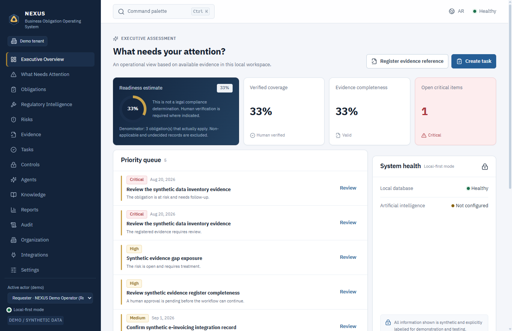

| العربية RTL | English LTR |
|---|---|
| 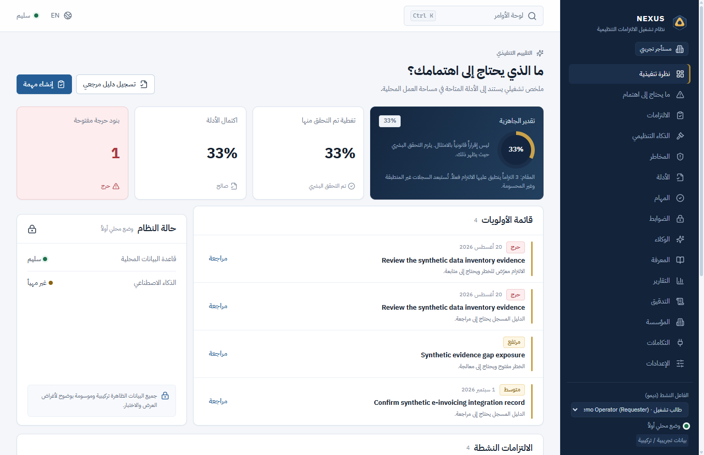 | 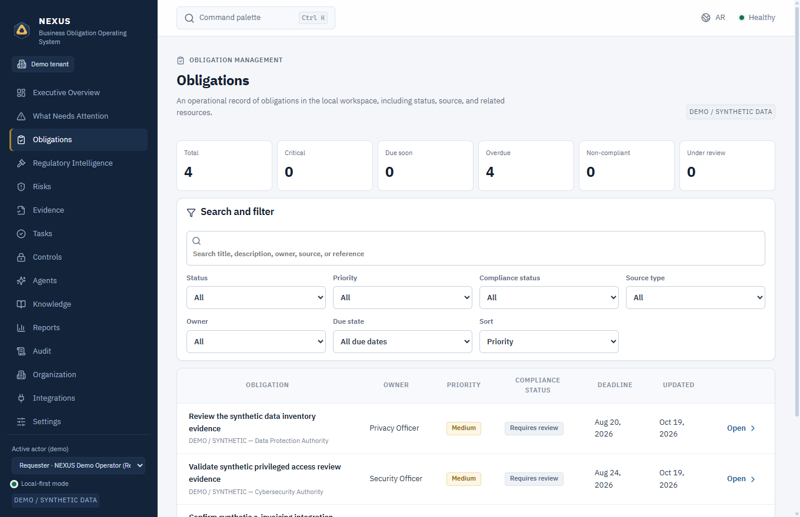 |
| 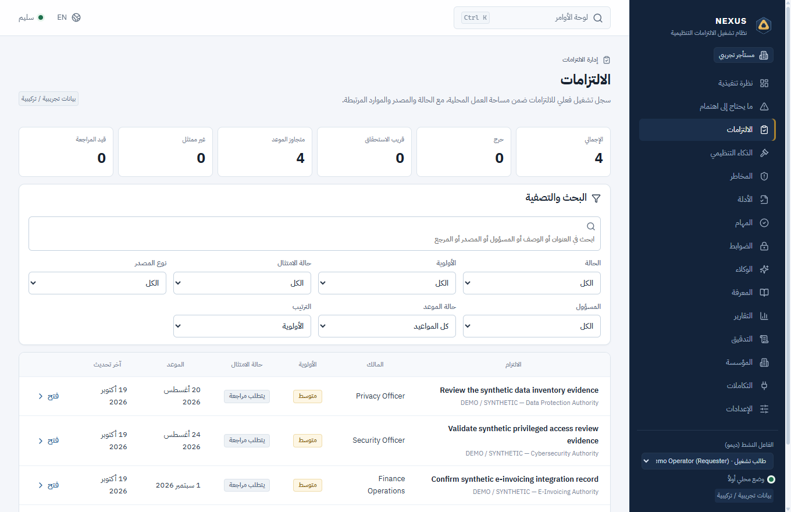 | 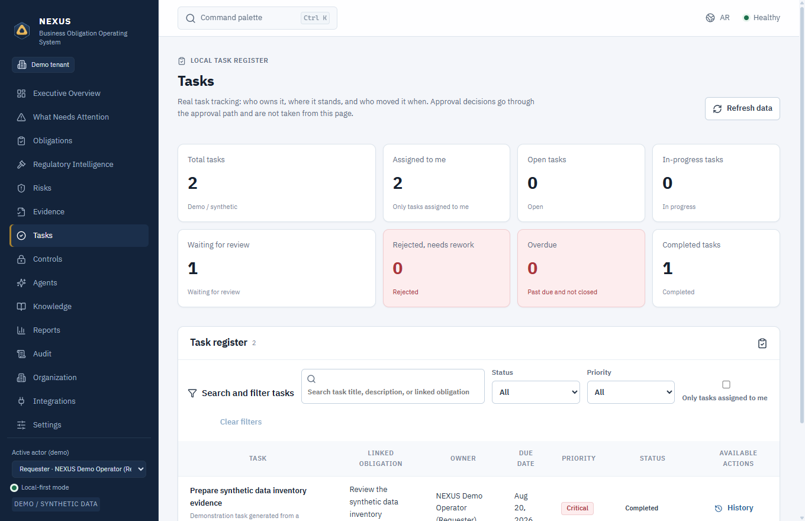 |
| 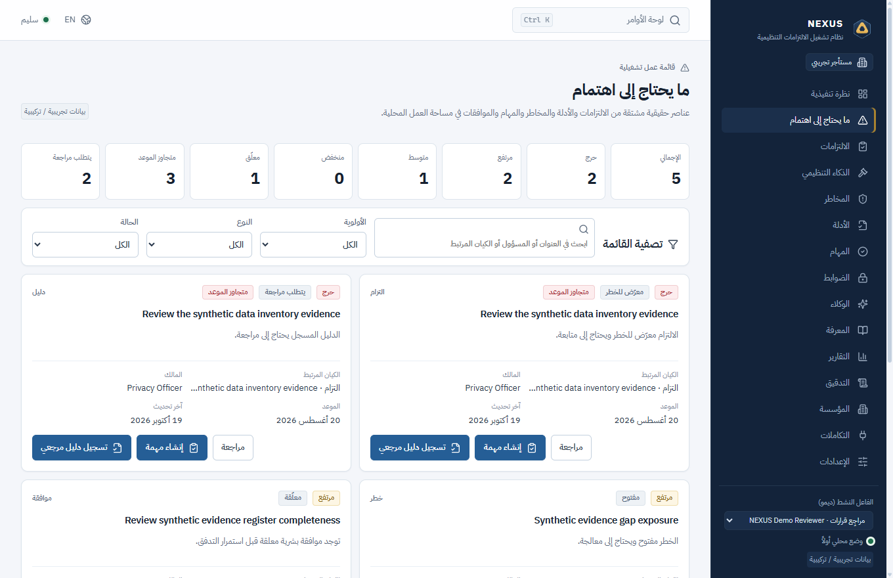 | 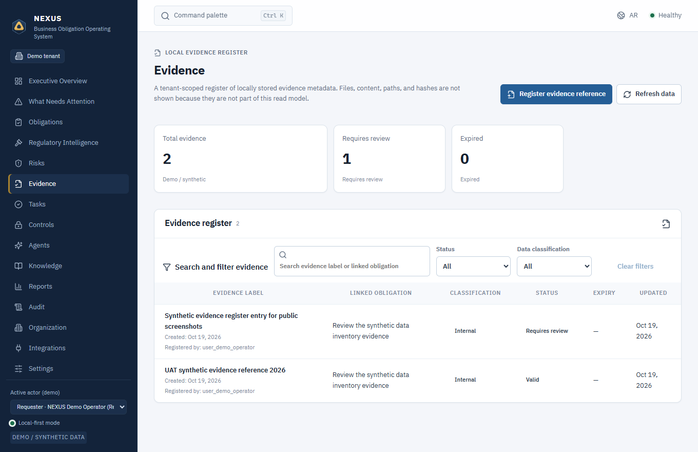 |
| 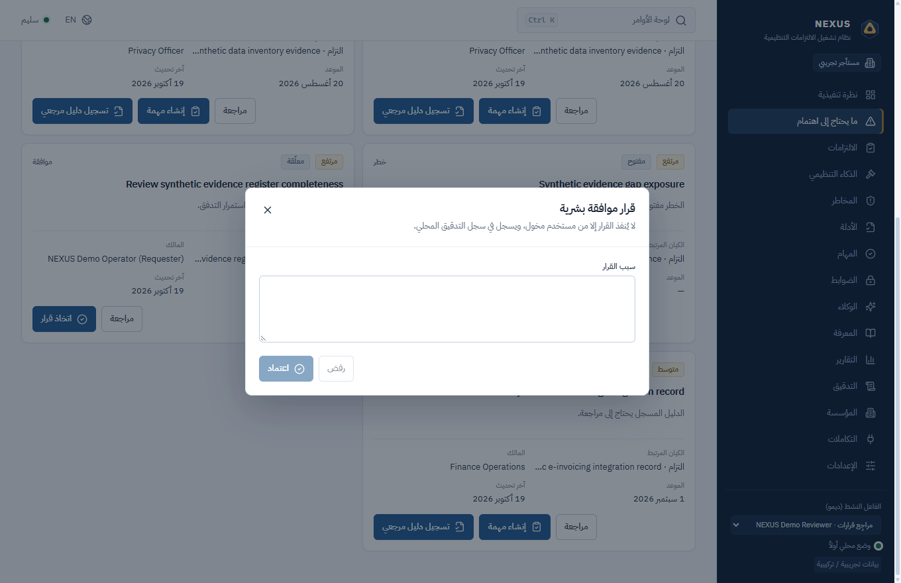 | 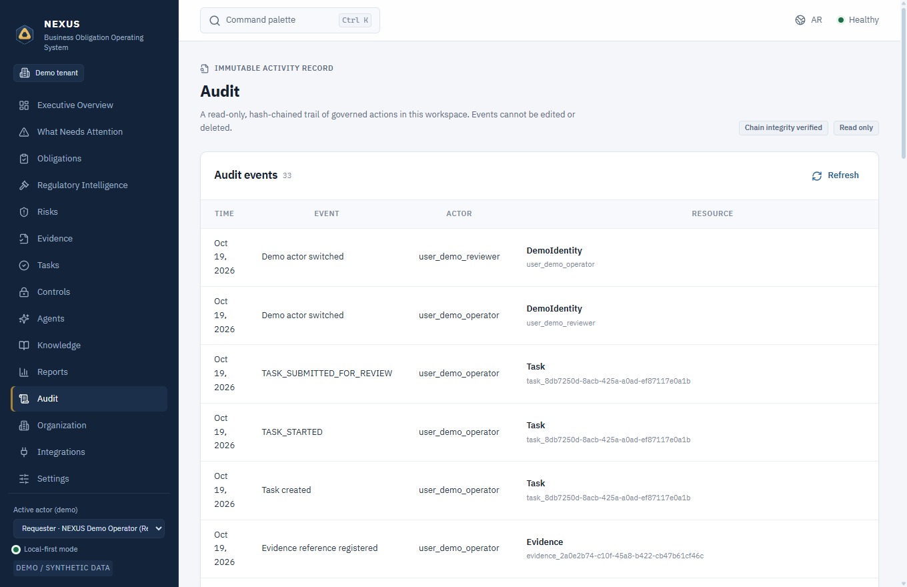 |

مزيد من الصور: [الأدلة](docs/images/screenshots/05-evidence-ar.png) · [الذكاء التنظيمي](docs/images/screenshots/03-regulatory-intelligence-ar.png) · [المخاطر](docs/images/screenshots/04-risks-ar.png) · [الضوابط](docs/images/screenshots/07-controls-ar.png) · [الوكلاء](docs/images/screenshots/08-agents-ar.png) · [المعرفة](docs/images/screenshots/09-knowledge-ar.png) · [التقارير](docs/images/screenshots/10-reports-ar.png) · [المؤسسة](docs/images/screenshots/12-organization-ar.png) · [التكاملات](docs/images/screenshots/13-integrations-en.png) · [مزوّدو AI](docs/images/screenshots/15-ai-providers-en.png) · [الإعدادات](docs/images/screenshots/14-settings-general-en.png)

## سلسلة العمل الأساسية

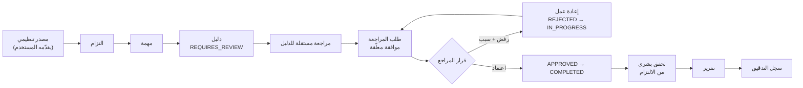

سير العمل وحالاته والقاعدة الخلفية التي تفرض كل خطوة موثقة في [المخطط 2 — سير العمل التنظيمي](docs/architecture/diagrams/02-regulatory-workflow.md). والرفض حالة مسجّلة فعلاً بسبب يعيد المهمة إلى إعادة العمل؛ وليس مسار خطأ.

## القدرات

### الحوكمة وإدارة العمل
- **الالتزامات** مرتبطة بمصادر تنظيمية مسجّلة، بمالك وموعد وأولوية وانطباق، مع أرشفة وتحقق بشري (`obligation:verify`).
- **المهام** بدورة حياة محكومة `OPEN → IN_PROGRESS → READY_FOR_REVIEW → APPROVED / REJECTED → COMPLETED`، وسجل انتقالات، وإسناد، وحماية تزامن بالإصدار.
- **الموافقات** تُنشأ بطلب المراجعة، ومرتبطة بإصدار المورد، ويقررها فاعل مستقل، ويعرض سبب الرفض على المنفّذ.
- **الأدلة المرجعية** بتحقق مستقل، وفصل `registered_by`، وبيانات انتهاء وتصنيف.
- **الضوابط** بتأليف وتقييم وربط بالالتزامات والمخاطر والأدلة.
- **التقارير** — ستة تعريفات محلية بمنشأ وصفوف محدودة، تُصدَّر CSV أو Markdown عبر حوار الحفظ الأصلي.

### دعم القرار
- **نظرة تنفيذية** — تقدير الجاهزية وتغطية التحقق واكتمال الأدلة والعناصر الحرجة المفتوحة وصحة النظام. والبيانات الناقصة تُعرض «غير مقيسة».
- **ما يحتاج إلى اهتمام** — قائمة واحدة مشتقة من الالتزامات والأدلة والمخاطر والمهام والموافقات، بإجراءات مسموحة.

### المنصة والثقة
- **تخزين SQLite محلي أولاً** — قاعدة واحدة في ملف تعريف المستخدم، بلا اعتماد سحابي ولا تليمتري ولا مزامنة خلفية.
- **نطاق مستأجر وRBAC** — فحص صلاحيات مربوط بالجلسة في Rust؛ والأدوار الإنتاجية `TENANT_ADMIN` و`CONTRIBUTOR` و`REVIEWER`.
- **تدقيق متسلسل بالتجزئة** — سلسلة SHA-256 مع مرساة محلية، وأمر تحقق فعلي يعيد حساب السلسلة.
- **ثنائية اللغة عربي/إنجليزي** — تبديل حقيقي RTL/LTR في الواجهة كاملة، وسبعة ثيمات منها التباين العالي.

### ذكاء اصطناعي محكوم (اختياري)
- **عشرة أنواع مزوّدين** بعناوين موثّقة ومحوّلات مختبَرة عقودياً؛ والاعتمادات محمية بـWindows DPAPI.
- **بلا وكلاء مستقلين** — كل تشغيل واستدعاء أداة يمر ببوابات التفويض والموافقة والتدقيق؛ ولا تنفيذ في الخلفية.
- **إعلان قدرات صادق** — البث غير منفّذ؛ واستدعاء الأدوات والمخرجات المهيكلة في محوّل Ollama الأصلي فقط؛ ولا مزوّد سحابي متحقق حيّاً (راجع [مزوّدو AI](docs/guides/ai-providers.ar.md)).
- **المعرفة** — مصادر TXT/Markdown بمنشأ، واسترجاع لفظي FTS5، واقتباسات. والاسترجاع المتجهي وإدخال PDF غير منفَّذين.

## الوحدات

يضم التنقل 15 وحدة، وكل وحدة تعلن نطاقها الحقيقي في الواجهة؛ وغير المنفَّذ يُعلن ولا يُزيَّف.

| # | الوحدة | الحالة | القيود المعروفة |
|---|---|---|---|
| 1 | نظرة تنفيذية | فعّالة، للقراءة | تقديرات محلية فقط؛ غير مقيسة عند نقص البيانات |
| 2 | ما يحتاج إلى اهتمام | فعّالة، مشتقة | القواعد المنفَّذة فقط؛ بلا تنقيط تنبؤي |
| 3 | الالتزامات | فعّالة | إنشاء/تعديل/أرشفة/تحقق؛ بلا استيراد جماعي |
| 4 | الذكاء التنظيمي | فعّال — مصادر يقدّمها المستخدم | بلا تغذية حية أو تحقق رسمي |
| 5 | المخاطر | **للقراءة فقط** | تأليف المخاطر وانتقالات دورة حياتها غير منفّذين |
| 6 | الأدلة | فعّالة | سجلات مرجعية فقط؛ بلا رفع ملفات أو PDF أو OCR |
| 7 | المهام | فعّالة | دورة حياة وانتقالات وموافقات؛ بلا جدولة أو إشعارات |
| 8 | الضوابط | فعّالة | تأليف/تقييم/ربط؛ بلا اختبار آلي للضوابط |
| 9 | الوكلاء | فعّالة، محكومة | تشغيل صريح فقط؛ بلا استقلالية خلفية |
| 10 | المعرفة | فعّالة | TXT/Markdown وFTS5؛ بلا بحث متجهي |
| 11 | التقارير | فعّالة | ستة تقارير وCSV/Markdown؛ ليست إقرار امتثال |
| 12 | التدقيق | للقراءة + تحقق | كاشف للتلاعب، لا مانع له ضد التحكم الكامل بالجهاز |
| 13 | المؤسسة | للقراءة فقط | وضع مشتق، لا مخطط تنظيمي قابل للتحرير |
| 14 | التكاملات | حالة للقراءة فقط | حالة المزوّدين/النماذج بصدق؛ بلا موصّلات سحابية |
| 15 | الإعدادات | فعّالة | المظهر واللغة والمزوّدون والنماذج والبيانات/المستخدمون والأمان وحول |

الجدول الدقيق للقدرات والقيود والعلاقات في [المخطط 6 — خريطة وحدات التطبيق](docs/architecture/diagrams/06-application-module-map.md).

## المعمارية

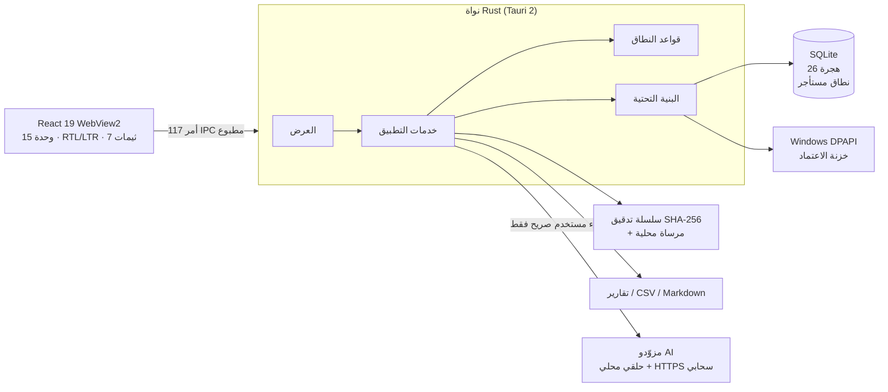

لا تملك الواجهة وصولاً مباشراً إلى قاعدة البيانات أو نظام الملفات أو الشبكة: ترسل أوامر مطبوعة فقط. وتُستنتج السلطة (الهوية والمستأجر والأدوار والصلاحيات) في Rust لكل أمر محمي. التفاصيل الكاملة وخمسة مخططات أخرى:

- [نظرة معمارية عامة](docs/architecture/diagrams/01-architecture-overview.md)
- [سير العمل التنظيمي](docs/architecture/diagrams/02-regulatory-workflow.md)
- [تكامل مزوّدي الذكاء الاصطناعي](docs/architecture/diagrams/03-ai-provider-integration.md)
- [الأمن وحدود الثقة](docs/architecture/diagrams/04-security-trust-boundaries.md)
- [تدفق البيانات والاستمرارية](docs/architecture/diagrams/05-data-flow-persistence.md)
- [خريطة وحدات التطبيق](docs/architecture/diagrams/06-application-module-map.md)

## المتطلبات

| المتطلب | الإصدار |
|---|---|
| Windows | 11 x64 |
| Node.js | >= 22 (مُختبر بـ24.14.1) |
| npm | >= 10 (القفل بـ`npm@11.11.0`) |
| Rust | >= 1.77.2 (مُختبر بـ1.97.1) مع MSVC و`rustfmt` |
| أدوات بناء C++ | Visual Studio Build Tools (حمل C++) + Windows SDK |
| WebView2 | Evergreen Runtime (مضمّن في Windows 11) |
| NSIS | يجلبه Tauri CLI لبناء المثبّت |

## تنزيل المصدر

```powershell
git clone https://github.com/D0shi-Eng/Nexus1.git
cd Nexus1
```

## البناء من المصدر

```powershell
npm ci
npm run desktop -- dev          # تشغيل تطبيق سطح المكتب في التطوير
npm run typecheck               # TypeScript
npm run lint                    # ESLint بصفر تحذيرات
npm run test                    # اختبارات الواجهة
npm run build                   # بناء واجهة الإنتاج
npm run tauri --workspace=@nexus/desktop -- build   # التطبيق + مثبّت NSIS
```

بوابات Rust:

```powershell
cd apps/desktop/src-tauri
cargo fmt --check
cargo check --all-targets
cargo test --lib -- --test-threads=1
```

مخرجات البناء المتوقعة واستكشاف الأخطاء في [دليل التثبيت](docs/guides/installation.ar.md).

## التثبيت المحلي

**لا يوجد مثبّت رسمي.** وإذا بنيت واحداً بنفسك فهو غير موقّع وقد يحذّر SmartScreen؛ وهذا الأثر لك لا إصداراً من NEXUS. راجع [التثبيت ← التثبيت المحلي](docs/guides/installation.ar.md).

## التشغيل الأول

1. شغّل التطبيق.
2. اختر أحد مسارين صريحين:
   - **بدء التجربة التجريبية** — مستأجر ديمو تركيبي وبيانات موسومة `DEMO / SYNTHETIC DATA`؛ بلا تسجيل دخول.
   - **تأسيس مساحة عمل إنتاجية** — اسم المؤسسة واسم المسؤول والدولة والقطاع وبريد المسؤول وكلمة مرور بسياسة 12–128 حرفاً. ولا تُبذر أي بيانات أعمال.
3. سجّل الدخول (إنتاج)، ثم أضف المستخدمين وأسند الأدوار من **الإعدادات ← البيانات والأمان**.
4. سجّل مصدراً، وأنشئ التزاماً، وأنشئ مهمة، وسجّل دليلاً، واطلب المراجعة، ثم قرّر الموافقة.

الدليل الكامل بكل صلاحية مطلوبة في [البدء والاستخدام](docs/guides/getting-started.ar.md).

## مزوّدو الذكاء الاصطناعي

عشرة أنواع ثابتة مدمجة: Ollama وLM Studio والمتوافق مع OpenAI وOpenAI وDeepSeek وAnthropic وQwen وZ.ai وxAI وOpenRouter.

| القدرة | الحقيقة في V1 |
|---|---|
| الاستنتاج المحلي | متحقق بـBonsai 2 عبر `127.0.0.1` من خلال محوّل OpenAI-compatible |
| مصادقة/استنتاج سحابي | **غير متحقق لأي مزوّد**؛ وثائق واختبارات عقود فقط |
| البث | **غير منفَّذ** — كل طلب `stream: false` |
| استدعاء الأدوات/المخرجات المهيكلة | في محوّل Ollama الأصلي فقط؛ والمحوّلات الأخرى تفشل مغلقة |
| الاعتمادات | Windows DPAPI (نطاق المستخدم)؛ لا تُخزَّن في SQLite ولا السجلات ولا التدقيق ولا IPC |
| التفعيل | صريح فقط؛ لا مزوّد مفعّل افتراضياً ولا نداء تلقائي |

المصفوفة الكاملة وخطوات الإعداد والقيود الموثّقة: [تكاملات مزوّدي الذكاء الاصطناعي](docs/guides/ai-providers.ar.md).

## الأمن وحماية البيانات

- **محلي أولاً:** قاعدة SQLite واحدة في `%LOCALAPPDATA%\com.nexus.obligationos`؛ بلا تليمتري ولا مزامنة ولا نشاط شبكي خلفي.
- **الهوية والوصول:** تجزئة Argon2id، وجلسات إنتاج 12 ساعة، وقفل تدريجي، وRBAC مربوط بالجلسة، ومستودعات داخل نطاق المستأجر، ومشغّلات SQLite تمنع نقل الملكية بين المستأجرين.
- **فصل المهام:** التحقق من الأدلة وقرارات الموافقة مستقلان عن مقدّم الطلب؛ ومفروضان في Rust لا في الواجهة.
- **التدقيق:** سلسلة SHA-256 مع مرساة محلية وتحقق فعلي وبيان صريح لحدود الثقة — من يتحكم بالجهاز كاملاً يستطيع إعادة كتابة القاعدة والمرساة معاً. والسلسلة **كاشفة للتلاعب لا مانعة له**.
- **الأسرار:** اعتمادات AI مشفّرة بـWindows DPAPI ولا تُحفظ نصاً صريحاً.
- **الشبكة:** سياسة وجهة بـHTTPS لغير الحلقي، وHTTP للحلقي فقط، وتثبيت DNS، وبلا تحويلات، وحدود حجم/مهلة.
- **التصدير:** حوار حفظ أصلي، وتحقق وجهة، وكتابة ذرّية محدودة، وحدث تدقيق لكل تصدير.
- **حدود معلنة:** SQLite غير مشفّرة بواسطة التطبيق؛ لا MFA/SSO؛ الثنائيات غير موقّعة؛ ولا اختبار اختراق مستقل ولا شهادة.

السياسة الكاملة: [الأمن والخصوصية](docs/guides/security.ar.md) · [SECURITY.md](SECURITY.md) · [نموذج التهديد](docs/security/threat-model.md).

## الاختبارات والجودة

المصدر متحقق منه بنفس بوابات CI:

| البوابة | النتيجة على مصدر الإصدار |
|---|---|
| `npm run typecheck` | ناجح |
| `npm run lint` (`--max-warnings=0`) | ناجح — 0 تحذير |
| `npm run test` | **202 اختباراً / 34 ملفاً** — 0 فشل |
| `npm run build` | ناجح |
| `cargo fmt --check` | ناجح |
| `cargo check --all-targets` | ناجح — 0 خطأ و0 تحذير |
| `cargo test --lib -- --test-threads=1` | **622 ناجحاً / 0 فاشل / 10 متجاهلة** |
| `npm audit` | 0 ثغرات |
| `cargo audit` | 0 ثغرات (تحذيران معلوماتيان غائبان عن هدف Windows) |
| فحص الأسرار (`tools/security/secret-scan.mjs`) | نظيف على شجرة النشر |
| UAT سطح مكتب على WebView2 حقيقي (حاوية معزولة) | **42/42 إنتاجي** و**23/23 ديمو** و**7/7 واجهة/لغات/ثيمات/وصولية** — أُعيد تشغيلها لهذا النشر |
| مصفوفة النافذة | 980×640 و1100×700 و1280×820 × RTL/LTR × فاتح/داكن/تباين عالٍ — **18/18 خلية و4632/4632 فحصاً** (أُعيد تشغيلها لهذا النشر) |
| التصدير الأصلي | أُعيد التحقق من حوار حفظ Windows الحقيقي وكتابة تقرير Markdown وحدث `REPORT_EXPORTED` واحد. وسجّل التشغيل الأصلي **18/18**؛ لكن تأكيدات المسار الحرفية تعتمد على المجلد الذي يتذكره حوار Windows (حالة ملف تعريف المستخدم). |

هذه قياسات لا تمنيات. الأوامر الدقيقة في [التطوير](docs/guides/development.ar.md) وسير عمل CI.

## القيود المعروفة

- **إصدار موقّع:** غير متاح. لا شهادة ولا مثبّت موقّع ولا ثنائي منشور.
- **المنصات:** Windows 11 x64 فقط.
- **الامتثال:** NEXUS لا يحدد الامتثال القانوني وليس منتج امتثال معتمداً.
- **حدود ثقة التدقيق:** مرساة محلية؛ والتحكم الكامل بالجهاز يتغلب عليها.
- **التشفير عند السكون:** القاعدة غير مشفّرة بواسطة التطبيق.
- **وحدة المخاطر:** للقراءة فقط في V1.
- **الأدلة:** بيانات مرجعية فقط؛ بلا رفع ملفات أو إدخال PDF أو OCR.
- **المعرفة:** FTS5 لفظي فقط؛ بلا استرجاع متجهي/تضميني.
- **الذكاء الاصطناعي:** البث غير منفّذ؛ واستدعاء الأدوات/المخرجات المهيكلة السحابية غير منفّذ؛ ولا مزوّد سحابي متحقق حيّاً.
- **الوصولية:** تحقق قارئ الشاشة جرى بـNVDA؛ وDPI غير 100% وشاشات برايل لم تُقس.
- **تعدد الأجهزة:** بلا مزامنة ولا خادم مركزي ولا SSO/MFA.

## المساهمة

المساهمات الخارجية مرحّب بها عند فتح المستودع للعموم؛ واقرأ [CONTRIBUTING.md](CONTRIBUTING.md) أولاً. فهو يحدد سياسة الفروع وقواعد الشيفرة وتوقعات الاختبار ونظافة الالتزامات (بلا مسارات شخصية وبلا أسرار) ومتطلب التوثيق ثنائي اللغة. و[CODE_OF_CONDUCT.md](CODE_OF_CONDUCT.md) ينطبق على كل مساحات المشروع.

## الترخيص

NEXUS مرخّص بموجب **Apache License 2.0**. راجع [LICENSE](LICENSE) و[NOTICE](NOTICE). وتحتفظ مكوّنات الأطراف الثالثة بتراخيصها؛ والجرد الكامل في [THIRD_PARTY_NOTICES.md](THIRD_PARTY_NOTICES.md) و[docs/legal/THIRD_PARTY_LICENSE_INVENTORY.md](docs/legal/THIRD_PARTY_LICENSE_INVENTORY.md). وخط IBM Plex Sans Arabic المضمّن بترخيص SIL OFL 1.1.

## الإبلاغ الأمني

يُرجى استخدام **GitHub Security Advisories** على `D0shi-Eng/Nexus1` للإفصاح الخاص. لا تفتح Issue عاماً يصف ثغرة، ولا تختبر بيانات مستخدم حقيقية. العملية الكاملة والإصدار المدعوم والنطاق: [الأمان والخصوصية](docs/guides/security.ar.md) و[SECURITY.md](SECURITY.md). ولا يوجد بريد شخصي منشور.

## الإصدار وحالة التوزيع

| | |
|---|---|
| الإصدار | `0.1.0` |
| ملاحظات الإصدار | [docs/RELEASE_NOTES_V1.md](docs/RELEASE_NOTES_V1.md) |
| إصدار ثنائي رسمي | **غير متاح** |
| مثبّت منشور | **لا يوجد** |
| GitHub Release | **لا يوجد** |
| تاريخ المصدر | تاريخ مستقل نظيف للمستودع العام |
| V2 | **لم يبدأ** |

---

<div align="center">

**NEXUS** — حوكمة محلية أولاً يمكن تدقيقها.
**Local-first governance you can audit.**

</div>

</div>
