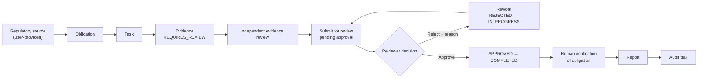
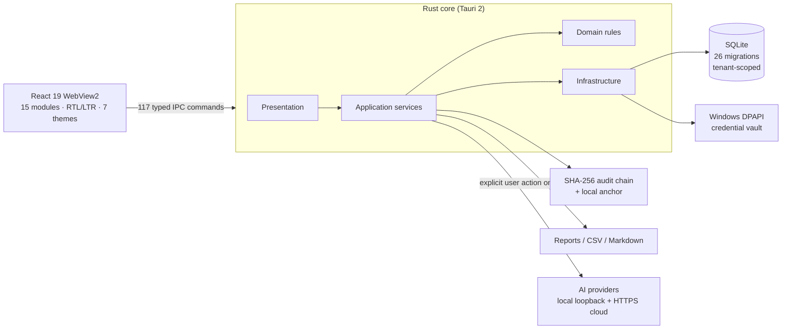

<div align="center">


# NEXUS

**Local-first governance for obligations, evidence and approvals**
**حوكمة محلية أولاً للالتزامات والأدلة والموافقات**

[العربية](README.ar.md) · **English**

[Architecture](docs/architecture/README.md) · [Installation](docs/guides/installation.md) · [Getting started](docs/guides/getting-started.md) · [AI providers](docs/guides/ai-providers.md) · [Security](docs/guides/security.md) · [Development](docs/guides/development.md)

</div>

---

## What NEXUS is

NEXUS is a **Windows 11 desktop application** for teams that need to run a governed obligation process end to end: register a regulatory source, derive a concrete obligation, execute tasks, register evidence, get an independent review, record an approval or rejection, verify the obligation, produce a report, and leave an auditable trail — **without sending the workspace to a server**.

It is built with **Tauri 2 · Rust · React 19 · TypeScript · SQLite**. All business data stays in a local SQLite database on the device. Identity, permissions, approvals, and audit are enforced in the Rust backend; the frontend only requests.

NEXUS does **not** decide legal compliance and is not legal advice. Readiness indicators are local operational estimates derived from the data and evidence present in the workspace. Human review remains required wherever the product says so.

## Project status

| | |
|---|---|
| Version | **0.1.0** — internally verified release candidate |
| Distribution | **Source only.** No official binary release, no published installer, no GitHub Release artifact |
| Signing | **Unsigned.** No code-signing certificate; the locally built installer is `NotSigned` |
| Platform | **Windows 11 x64** only (no macOS or Linux build) |
| License | **Apache-2.0** — see [LICENSE](LICENSE) and [NOTICE](NOTICE) |
| Repository | `D0shi-Eng/Nexus1` (clean independent source history) |

> There is no download button for an installer because no installer has been published. Building from source is documented and verified: [installation guide](docs/guides/installation.md).

## Why NEXUS

Compliance and governance work fails in the gap between **what was required**, **what was done**, and **who confirmed it**. Spreadsheets store the records but not the authority; chat threads store approvals but not the evidence; document folders store evidence but not the link to the obligation.

NEXUS treats the whole chain as one governed record:

- **Provenance** — every obligation points back to a registered source, and the source is explicitly user-provided (never presented as an official feed).
- **Separation of duties** — the person who registers evidence cannot verify it; the person who requests approval cannot decide it.
- **Accountability** — every transition, decision, rejection reason, export, and configuration change produces a hash-chained audit event.
- **Local ownership** — the database, the audit anchor, and the credentials live on the device; nothing is synced or telemetered.

**Designed for:** compliance, risk, governance, internal audit, and operations teams in small and mid-sized organizations; consultants who need a defensible working record for a client engagement; and developers evaluating a local-first governance architecture.

**Not designed for:** multi-organization hosting, real-time collaboration between devices, automatic regulatory monitoring, or replacing legal advice.

## Screenshots — real application, synthetic demo data

Every screenshot below is a real capture of NEXUS `0.1.0` running in an **isolated demo container** with synthetic data. The DEMO / SYNTHETIC DATA label is part of the product. No user data, personal account, or API key appears in any image.


| Arabic RTL | English LTR |
|---|---|
|  |  |
|  |  |
|  |  |
|  |  |

More screenshots: [evidence](docs/images/screenshots/05-evidence-ar.png) · [regulatory intelligence](docs/images/screenshots/03-regulatory-intelligence-ar.png) · [risks](docs/images/screenshots/04-risks-ar.png) · [controls](docs/images/screenshots/07-controls-ar.png) · [agents](docs/images/screenshots/08-agents-ar.png) · [knowledge](docs/images/screenshots/09-knowledge-ar.png) · [reports](docs/images/screenshots/10-reports-ar.png) · [organization](docs/images/screenshots/12-organization-ar.png) · [integrations](docs/images/screenshots/13-integrations-en.png) · [AI providers](docs/images/screenshots/15-ai-providers-en.png) · [settings](docs/images/screenshots/14-settings-general-en.png)

## Core workflow



The workflow, each state, and the backend rule that enforces it are documented in [Diagram 2 — Regulatory Workflow](docs/architecture/diagrams/02-regulatory-workflow.md). Rejection is a real recorded state with a reason that returns the task to rework; it is not an error path.

## Features

### Governance and work management
- **Obligations** linked to registered regulatory sources, with owner, due date, priority, applicability, archive, and human verification (`obligation:verify`).
- **Tasks** with a governed lifecycle `OPEN → IN_PROGRESS → READY_FOR_REVIEW → APPROVED / REJECTED → COMPLETED`, a transition log, assignment, and concurrency-safe version checks.
- **Approvals** created by review requests, bound to the resource version, decided by an independent actor, with rejection reasons visible to the assignee.
- **Evidence references** with independent verification, `registered_by` separation of duties, expiry and classification metadata.
- **Controls** that can be authored, assessed, and linked to obligations, risks, and evidence.
- **Reports** — six local definitions with provenance and bounded rows, exportable as CSV or Markdown through the native save dialog.

### Decision support
- **Executive Overview** — readiness estimate, verified coverage, evidence completeness, open critical items, system health. Missing data is shown as unmeasured.
- **What Needs Attention** — one queue derived from obligations, evidence, risks, tasks, and approvals, with permitted actions.

### Platform and trust
- **Local-first SQLite storage** — one database in the user's profile, no cloud dependency, no telemetry, no background sync.
- **Tenant scoping and RBAC** — session-bound permission checks in Rust; production roles `TENANT_ADMIN`, `CONTRIBUTOR`, `REVIEWER`.
- **Hash-chained audit** — SHA-256 chain plus a local anchor, with an actual verification command that recomputes the chain.
- **Bilingual Arabic/English** — true RTL/LTR switching across the whole interface, seven themes including high contrast.

### Governed AI (optional)
- **Ten provider kinds** with documented endpoints and contract-tested adapters; credentials protected by Windows DPAPI.
- **No autonomous agents** — every run and tool invocation passes authorization, approval, and audit gates; no background execution.
- **Honest capability reporting** — streaming is not implemented; tool calling and structured output exist only in the native Ollama adapter; no cloud provider is live-verified (see [AI providers](docs/guides/ai-providers.md)).
- **Knowledge** — TXT/Markdown sources with provenance, FTS5 lexical retrieval, and citations. Vector retrieval and PDF ingestion are not implemented.

## Modules

The navigation has 15 modules. Each one states its real scope in the UI; non-implemented capabilities are declared, not faked.

| # | Module | Status | Known limits |
|---|---|---|---|
| 1 | Executive Overview | Functional, read-only | Local estimates only; unmeasured when data is missing |
| 2 | What Needs Attention | Functional, derived | Only the implemented rules; no predictive scoring |
| 3 | Obligations | Functional | Create/edit/archive/verify; no bulk import |
| 4 | Regulatory Intelligence | Functional — user-provided sources | No live feeds or official verification |
| 5 | Risks | **Read-only** | Risk authoring and lifecycle transitions not implemented |
| 6 | Evidence | Functional | Reference records only; no file upload, PDF ingestion, or OCR |
| 7 | Tasks | Functional | Lifecycle, transitions, approvals; no scheduler or notifications |
| 8 | Controls | Functional | Author/assess/link; no automated control testing |
| 9 | Agents | Functional, governed | Explicit runs only; no background autonomy |
| 10 | Knowledge | Functional | TXT/Markdown, FTS5; no vector search |
| 11 | Reports | Functional | Six reports, CSV/Markdown; not a compliance assertion |
| 12 | Audit | Read-only + verify | Tamper-evident, not tamper-proof against full device control |
| 13 | Organization | Read-only | Derived posture, not an editable org chart |
| 14 | Integrations | Read-only status | Truthful provider/model status; no cloud connectors |
| 15 | Settings | Functional | Appearance, language, providers, models, data/users, security, about |

A precise capability/limitation table with relations is in [Diagram 6 — Application Module Map](docs/architecture/diagrams/06-application-module-map.md).

## Architecture



The WebView has no direct database, filesystem, or network access: it can only send typed commands. Authority (identity, tenant, roles, permissions) is resolved in Rust for every protected command. Full details and five more diagrams:

- [Architecture Overview](docs/architecture/diagrams/01-architecture-overview.md)
- [Regulatory Workflow](docs/architecture/diagrams/02-regulatory-workflow.md)
- [AI Provider Integration](docs/architecture/diagrams/03-ai-provider-integration.md)
- [Security & Trust Boundaries](docs/architecture/diagrams/04-security-trust-boundaries.md)
- [Data Flow & Persistence](docs/architecture/diagrams/05-data-flow-persistence.md)
- [Application Module Map](docs/architecture/diagrams/06-application-module-map.md)

## Requirements

| Requirement | Version |
|---|---|
| Windows | 11 x64 |
| Node.js | >= 22 (tested with 24.14.1) |
| npm | >= 10 (lockfile: `npm@11.11.0`) |
| Rust | >= 1.77.2 (tested with 1.97.1), MSVC toolchain + `rustfmt` |
| C++ build tools | Visual Studio Build Tools (C++ workload) + Windows SDK |
| WebView2 | Evergreen Runtime (included with Windows 11) |
| NSIS | bundled by the Tauri CLI for installer builds |

## Download the source

```powershell
git clone https://github.com/D0shi-Eng/Nexus1.git
cd Nexus1
```

## Build from source

```powershell
npm ci
npm run desktop -- dev          # run the desktop app in development
npm run typecheck               # TypeScript
npm run lint                    # ESLint, zero warnings
npm run test                    # frontend tests
npm run build                   # production frontend build
npm run tauri --workspace=@nexus/desktop -- build   # application + NSIS installer
```

Rust gates:

```powershell
cd apps/desktop/src-tauri
cargo fmt --check
cargo check --all-targets
cargo test --lib -- --test-threads=1
```

Expected build outputs and troubleshooting are in the [installation guide](docs/guides/installation.md).

## Install locally

There is **no official installer**. If you build one yourself it is unsigned and SmartScreen may warn; that artifact is yours, not a NEXUS release. See [Installation → Install locally](docs/guides/installation.md#8-install-locally-optional-your-own-build).

## First run

1. Launch the application.
2. Choose one of two explicit paths:
   - **Start demo experience** — synthetic demo tenant and data, clearly labelled `DEMO / SYNTHETIC DATA`; no sign-in.
   - **Provision production workspace** — organization name, administrator name, country, industry, admin email, and a password following the 12–128 character policy. No business data is seeded.
3. Sign in (production), then add users and assign roles from **Settings → Data & security**.
4. Register a source, create an obligation, create a task, register evidence, request review, and decide the approval.

The complete walkthrough, including every permission required, is in [Getting Started](docs/guides/getting-started.md).

## AI providers

Ten fixed kinds are integrated: Ollama, LM Studio, OpenAI-compatible, OpenAI, DeepSeek, Anthropic, Qwen, Z.ai, xAI, and OpenRouter.

| Capability | Reality in V1 |
|---|---|
| Local inference | Verified with Bonsai 2 over `127.0.0.1` through the OpenAI-compatible adapter |
| Cloud authentication / inference | **Not verified for any provider**; documentation + contract tests only |
| Streaming | **Not implemented** — every request uses `stream: false` |
| Tool calling / structured output | Implemented only in the native Ollama adapter; other adapters fail closed |
| Credentials | Windows DPAPI (user scope); never in SQLite, logs, audit, or IPC responses |
| Enablement | Explicit only; no provider is enabled by default and no call is automatic |

Full matrix, setup steps, and documented limitations: [AI Provider Integrations](docs/guides/ai-providers.md).

## Security and data protection

- **Local-first:** one SQLite database in `%LOCALAPPDATA%\com.nexus.obligationos`; no telemetry, no sync, no background network activity.
- **Identity and access:** Argon2id password hashing, 12-hour production sessions, progressive lockout, session-bound RBAC, tenant-scoped repositories, and SQLite triggers against cross-tenant re-parenting.
- **Separation of duties:** evidence verification and approval decisions are independent of the submitter; enforced in Rust, not the UI.
- **Audit:** SHA-256 hash chain with a local anchor, real verification, and an explicit statement of the trust boundary — a party controlling the whole device can rewrite database and anchor together. The audit chain is **tamper-evident, not tamper-proof**.
- **Secrets:** AI credentials encrypted with Windows DPAPI; never persisted in plain text.
- **Network:** destination policy with HTTPS off-loopback, loopback-only HTTP, pinned DNS, no redirects, and bounded size/timeouts.
- **Export:** native save dialog, destination validation, atomic bounded writes, one audit event per export.
- **Honest gaps:** SQLite is not encrypted by the application; no MFA/SSO; binaries are unsigned; no independent penetration test or certification.

Read the full policy: [Security and Privacy](docs/guides/security.md) · [SECURITY.md](SECURITY.md) · [threat model](docs/security/threat-model.md).

## Tests and quality

The release source is verified by the same gates the CI workflow runs:

| Gate | Result on the release source |
|---|---|
| `npm run typecheck` | Pass |
| `npm run lint` (`--max-warnings=0`) | Pass — 0 warnings |
| `npm run test` | **202 tests / 34 files** — 0 failures |
| `npm run build` | Pass |
| `cargo fmt --check` | Pass |
| `cargo check --all-targets` | Pass — 0 errors, 0 warnings |
| `cargo test --lib -- --test-threads=1` | **622 passed / 0 failed / 10 ignored** |
| `npm audit` | 0 vulnerabilities |
| `cargo audit` | 0 vulnerabilities (two informational advisories not present in the Windows target) |
| Secret scan (`tools/security/secret-scan.mjs`) | Clean over the published tree |
| Desktop UAT on a real WebView2 (isolated container) | **42/42 production** and **23/23 demo** and **7/7 UI/i18n/themes/accessibility** — all re-run for this publication |
| Window matrix | 980×640, 1100×700, 1280×820 × RTL/LTR × light/dark/high-contrast — **18/18 cells, 4632/4632 checks** (re-run for this publication) |
| Native export | Real Windows save dialog, written Markdown report, and one `REPORT_EXPORTED` audit event re-verified. The recorded harness run scored **18/18**; its exact-path assertions depend on the Windows dialog's remembered folder, which is user-profile state. |

These are measurements, not aspirations. The exact commands are in [Development](docs/guides/development.md) and the CI workflow.

## Known limitations

- **Signed release:** unavailable. No certificate, no signed installer, no published binary.
- **Platforms:** Windows 11 x64 only.
- **Compliance:** NEXUS does not determine legal compliance and is not a certified compliance product.
- **Audit trust boundary:** local anchor; full device control defeats it.
- **Encryption at rest:** the database is not encrypted by the application.
- **Risks module:** read-only in V1.
- **Evidence:** reference metadata only; no file upload, PDF ingestion, or OCR.
- **Knowledge:** lexical FTS5 only; no vector/embedding retrieval.
- **AI:** streaming not implemented; cloud tool calling/structured output not implemented; no cloud provider live-verified.
- **Accessibility:** screen-reader verification was performed with NVDA; DPI scaling other than 100% and braille displays were not measured.
- **Multi-device:** no sync, no central server, no SSO/MFA.

## Contributing

External contributions are welcome once the repository is public; read [CONTRIBUTING.md](CONTRIBUTING.md) first. It defines branch policy, coding rules, test expectations, commit hygiene (no personal paths, no secrets), and the bilingual documentation requirement. [CODE_OF_CONDUCT.md](CODE_OF_CONDUCT.md) applies to all project spaces.

## License

NEXUS is licensed under the **Apache License 2.0**. See [LICENSE](LICENSE) and [NOTICE](NOTICE). Third-party components keep their own licenses; the full inventory is in [THIRD_PARTY_NOTICES.md](THIRD_PARTY_NOTICES.md) and [docs/legal/THIRD_PARTY_LICENSE_INVENTORY.md](docs/legal/THIRD_PARTY_LICENSE_INVENTORY.md). The bundled IBM Plex Sans Arabic font is licensed under SIL OFL 1.1.

## Security reporting

Please use **GitHub Security Advisories** on `D0shi-Eng/Nexus1` for private disclosure. Do not open a public issue describing a vulnerability, and do not test against real user databases. Full process, supported version, and scope: [Security and Privacy](docs/guides/security.md) and [SECURITY.md](SECURITY.md). No personal e-mail is published.

## Version and distribution status

| | |
|---|---|
| Version | `0.1.0` |
| Release notes | [docs/RELEASE_NOTES_V1.md](docs/RELEASE_NOTES_V1.md) |
| Official binary release | **Not available** |
| Published installer | **None** |
| GitHub Release | **None** |
| Source history | Independent clean history for the public repository |
| V2 | **Not started** |

---

<div align="center">

**NEXUS** — local-first governance you can audit.
**نظام محلي أولاً للحوكمة يمكن تدقيقه.**

</div>
