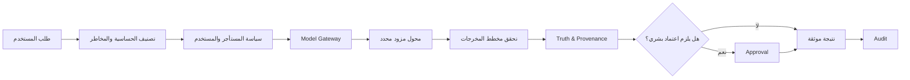

# حوكمة الذكاء الاصطناعي — خط أساس MVP

**الحالة:** معتمد معماريًا، غير مفعّل وظيفياً حتى تهيئة مزود فعلي  
**المبدأ:** لا يكون خرج الذكاء الاصطناعي حقيقة مرجعية أو إجراءً حاسماً بذاته.

## بنية القرار

## قواعد ثابتة

| القاعدة | التنفيذ المطلوب |
|---|---|
| لا اعتماد مزود ضمن الواجهة | تكون الأسرار في مخزن آمن والنقل من Rust فقط. |
| لا مخرجات نصية حرة للأعمال الحرجة | تستخدم مخططات إدخال/إخراج والتحقق من المجال والسياسة. |
| لا سياق بدون تصنيف | يفلتر السياق بحسب tenant والدور والتصنيف والغرض قبل أي استدعاء. |
| لا انتقال صامت بين الموديلات | لكل نموذج حالة وقدرات وسياسة؛ لا fallback يخالف سياسة المستأجر. |
| لا ذاكرة دائمة افتراضياً | كل كتابة ذاكرة تحمل صلاحية وثقة ومصدر وسياسة حذف. |
| لا أدوات وكيل افتراضية | كل مهارة تعلن الأدوات المسموح بها وحدودها ومخاطرها. |
| لا سلسلة تفكير مخفية | يعرض التطبيق ملخص تعليل قابل للتحقق ومصادر، لا تفكير داخلي خام. |

## سجل مكونات الحوكمة

| السجل | الحقول الدنيا | حالة MVP |
|---|---|---|
| Model Registry | provider, model_id, capabilities, local/cloud, status, policy | عقد فقط. |
| Prompt Registry | id, version, hash, author, tests, score | عقد فقط. |
| Agent Registry | identity, mission, risk, skills, tools, permissions, version | عقد أولي لاحق. |
| Skill Registry | inputs, outputs, constraints, validation, permissions, tests | عقد أولي لاحق. |
| Tool Registry | scope, rate limit, authorization, audit policy | عقد أولي لاحق. |
| Evaluation Registry | dataset, metric, version, pass threshold | مخطط قبل تشغيل AI. |

## سياسة المخاطر

| المستوى | المعنى | سلوك التطبيق |
|---|---|---|
| L0 | معلومات | عرض نتيجة موثقة؛ لا تعديل. |
| L1 | تحليل | عرض تفسير ومصادر وثقة؛ لا تعديل حاسم. |
| L2 | توصية | إنشاء توصية/مسودة قابلة للمراجعة. |
| L3 | إجراء بموافقة | ينشئ طلب موافقة ولا ينفذ قبل قرار صالح. |
| L4 | أثر عالٍ | محظور ذاتياً؛ يحتاج تفويضاً وموافقة صريحة وربما قواعد إضافية. |

## بيانات الذكاء في التطوير

لا تعرض الواجهة نجاحاً اصطناعياً عند غياب مزود. تعرض الحالة `NOT_CONFIGURED` مع سبب آمن وخطوات إعداد داخل صفحة الإدارة. تستخدم بيانات `DEMO / SYNTHETIC` فقط في اختبارات المخطط والواجهة، ولا تسميها تحليلاً تنظيمياً فعلياً.
