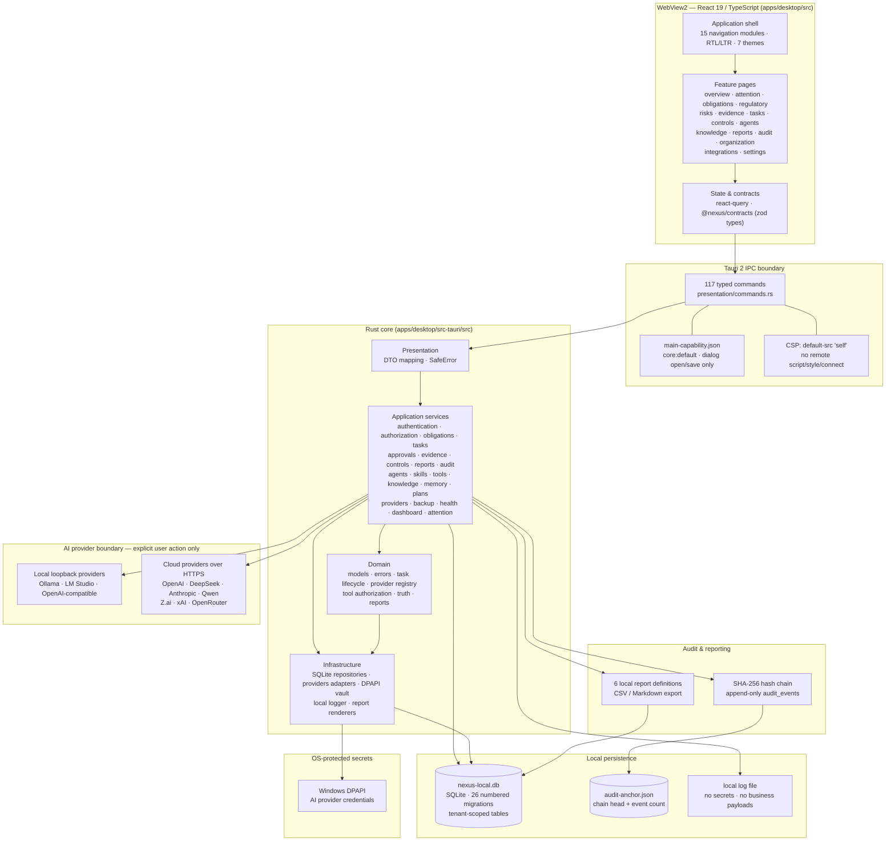

# Diagram 1 — Architecture Overview

**Scope:** the implemented NEXUS V1 desktop architecture (source: `apps/desktop`).
**Rendered by:** GitHub Mermaid.

## What the diagram states — and what it deliberately omits

- Every business operation passes through one of the **117 `#[tauri::command]` functions** registered in `lib.rs`. The WebView never opens SQLite, files, or the network directly: the only Tauri capabilities granted are `core:default`, `dialog:allow-open`, and `dialog:allow-save`.
- The UI can only **request**; authority (identity, tenant, roles, permissions) is resolved in Rust. The frontend never sends or chooses a tenant.
- **AI providers are optional and explicit.** Local providers run on loopback; cloud providers are only contacted after the user configures a provider and triggers a call, subject to the destination policy. No provider is enabled by default (the seeded Ollama row starts `enabled = 0`, `connection_state = UNVERIFIED`).
- **Reporting reads** from the same tenant-scoped tables and writes only through the native save dialog; it is not a separate analytics service.
- There is **no cloud sync, no telemetry, no background network worker, and no server-side component** in V1. No such box is drawn.
- The audit anchor lives **inside the application data directory** — it is a local reference, not an external trusted timestamp. It is not drawn as a remote or hardware-backed root of trust.

## Arabic summary — ملخّص عربي

يعرض المخطط المعمارية الفعلية المنفَّذة في V1: واجهة React داخل WebView2 تتواصل عبر حدود IPC محددة (117 أمراً) مع نواة Rust مقسّمة إلى طبقات (عرض، خدمات تطبيق، نطاق، بنية تحتية)، وقاعدة SQLite محلية بهجرات مرقمة 0001–0026، وخزنة اعتماد محمية بـDPAPI، ومزوّدي ذكاء اصطناعي محليين/سحابيين لا يُستدعون إلا بإجراء صريح من المستخدم، وسلسلة تدقيق SHA-256 مع مرساة محلية. لا توجد مزامنة سحابية ولا تليمتري ولا خدمة خلفية — ولهذا لا تظهر في المخطط.
