# Diagram 2 — Regulatory Workflow

**Scope:** the implemented V1 workflow across the 15 modules. Every arrow corresponds to a real command/service path in the Rust backend; rejection and rework are first-class states, not an exception path.

```mermaid
flowchart LR
  subgraph INTAKE["1 · Intake"]
    SOURCE["Regulatory source<br/>(user-provided record)<br/>authority · document · version · URL"]
    OBL["Obligation<br/>linked to the source<br/>owner · priority · due date · applicability"]
  end

  subgraph EXECUTION["2 · Execution"]
    TASK["Task<br/>OPEN → IN_PROGRESS"]
    BLOCKED["Task BLOCKED"]
    EVIDENCE["Evidence reference<br/>REQUIRES_REVIEW"]
  end

  subgraph REVIEW["3 · Independent human review"]
    EVID_DECISION{"Evidence decision<br/>VALID · INVALID · EXPIRED"}
    SUBMIT["Task READY_FOR_REVIEW<br/>creates a pending approval"]
    APPROVAL{"Approval decision<br/>independent reviewer"}
    REJECTED["Task REJECTED<br/>reason recorded"]
    APPROVED["Task APPROVED"]
  end

  subgraph CLOSURE["4 · Closure and accountability"]
    COMPLETED["Task COMPLETED<br/>(terminal)"]
    VERIFY["Obligation human verification<br/>obligation:verify"]
    REPORT["Report<br/>6 local definitions"]
    AUDIT["Audit event per step<br/>SHA-256 hash chain"]
  end

  SOURCE -->|"regulatory_intelligence:create"| OBL
  OBL -->|"task:create"| TASK
  TASK -->|"task:update"| BLOCKED
  BLOCKED -->|"task:update"| TASK
  TASK -->|"evidence:create<br/>not by the evidence registrant"| EVIDENCE
  EVIDENCE --> EVID_DECISION
  EVID_DECISION -->|"evidence:update<br/>reviewer only"| SUBMIT
  SUBMIT --> APPROVAL
  APPROVAL -->|"approval:decide · reject"| REJECTED
  REJECTED -->|"task:update · rework"| TASK
  APPROVAL -->|"approval:decide · approve"| APPROVED
  APPROVED -->|"task:update · close"| COMPLETED
  COMPLETED -->|"obligation:verify"| VERIFY
  VERIFY --> REPORT
  TASK --> AUDIT
  EVID_DECISION --> AUDIT
  APPROVAL --> AUDIT
  COMPLETED --> AUDIT
  REPORT --> AUDIT

  classDef rejected fill:#fde8e8,stroke:#b42318,color:#7a271a;
  class REJECTED rejected;
  classDef approved fill:#e7f6ec,stroke:#067647,color:#05603a;
  class APPROVED,COMPLETED approved;
```

## Implemented behaviour this diagram encodes

| Rule | Where it is enforced |
|---|---|
| A task cannot be requested for review without registered evidence | `task_service::transition_task` refuses `READY_FOR_REVIEW` until the obligation has evidence; the UI only reflects the backend decision. |
| The person who registered evidence cannot decide its verification state | migration `0026` adds `evidence_items.registered_by`; `update_evidence_status` rejects self-verification even through direct IPC. |
| A requester cannot approve their own work | `approval_service` / `task_lifecycle` only allow the approval actor to move `READY_FOR_REVIEW → APPROVED / REJECTED`; self-approval is rejected in Rust. |
| Rejection is a recorded state with a reason, and rework resumes from `IN_PROGRESS` | `tasks.status = REJECTED`, `approvals.reason`, `task_transitions` history; the timeline is visible in the UI and the audit trail. |
| `COMPLETED` is terminal | `task_lifecycle::is_terminal` and the transition evaluator reject any transition out of `COMPLETED`. |
| Every step leaves an audit event | `append_audit_event` inside the same transaction as the business write. |

## Arabic summary — ملخّص عربي

يمثّل المخطط المسار التنفيذي الحقيقي: مصدر تنظيمي يقدّمه المستخدم ← التزام ← مهمة قابلة للتنفيذ (مع حالة تعليق) ← دليل مرجعي بحالة «يتطلب مراجعة» ← قرار تحقق مستقل على الدليل ← طلب مراجعة يُنشئ موافقة معلّقة ← قرار اعتماد أو رفض مسجّل بالسبب ← إعادة عمل عند الرفض ← اعتماد ← إغلاق نهائي ← تحقق بشري من الالتزام ← تقرير ← تدقيق. القيود المهمة: لا طلب مراجعة بلا دليل، ولا يقرر مقدّم الدليل حالة دليله، ولا يعتمد الطالب عمله، والحالة `COMPLETED` نهائية، وكل خطوة تُقيَّد في سلسلة التدقيق.
