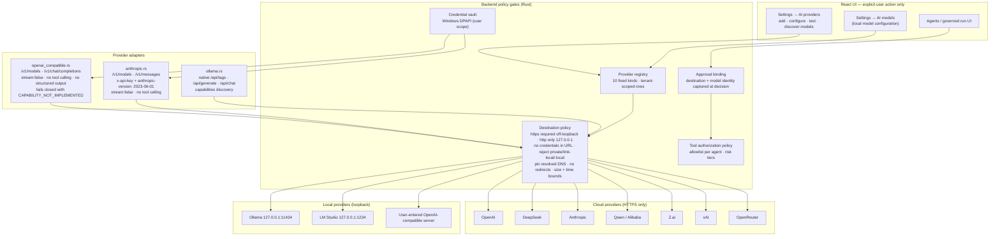

# Diagram 3 — AI Provider Integration

**Scope:** the implemented provider registry, adapters, and network policy. Only paths that exist in `apps/desktop/src-tauri/src/infrastructure/providers/` and `application/ai_provider_registry_service.rs` are drawn.

## What is real, and what is intentionally absent

- **Streaming is not implemented.** Every adapter sends `stream: false`; no SSE token stream is drawn.
- **Tool calling is implemented only in the native Ollama adapter.** The OpenAI-compatible and Anthropic adapters reject it with `CAPABILITY_NOT_IMPLEMENTED`; no tool loop is drawn for them.
- **Structured JSON output is implemented only in the native Ollama adapter** (`format: "json"` on `/api/generate`).
- **No provider is auto-enabled, and no background call exists.** The built-in Ollama row starts disabled and `UNVERIFIED`; cloud calls happen only after the user stores a key and invokes a run.
- **No credentials flow into SQLite, logs, audit events, or IPC responses.** The vault is DPAPI user-scoped; the key is read only at request time.
- **Cloud provider capability claims are documentation-level plus contract tests only.** No cloud provider has live authentication or live inference verification (see `docs/guides/ai-providers.md`).
- The diagram does **not** draw a generic "AI orchestrator cloud" or any hidden intermediary: requests go from the Rust adapter to the provider endpoint directly.

## Arabic summary — ملخّص عربي

يعرض المخطط مسار تكامل مزوّدي الذكاء الاصطناعي كما هو منفَّذ: إعداد صريح من الواجهة ← سجل المزوّدين (10 أنواع ثابتة) ← سياسة وجهة صارمة (HTTPS لغير الحلقي، والحلقي `127.0.0.1` فقط، بلا بيانات اعتماد في العنوان، وتثبيت DNS، وبلا تحويلات، وحدود حجم ومهلة) ← محوّل المحادثة. المفاتيح في خزنة DPAPI ولا تُسجَّل. البث غير منفَّذ في أي محوّل، واستدعاء الأدوات والمخرجات المهيكلة منفَّذان في مسار Ollama الأصلي فقط، والمحوّلان الآخران يفشلان مغلقين بدل ادعاء قدرة غير موجودة. لا توجد مزامنة ولا استدعاء خلفي تلقائي.
