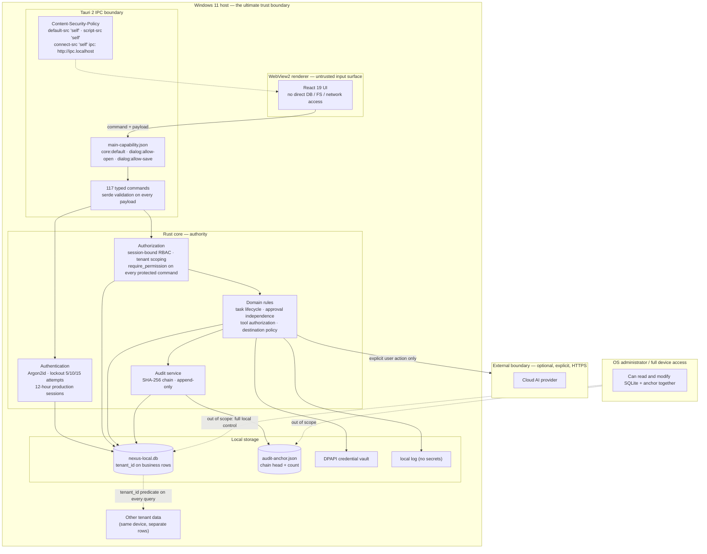

# Diagram 4 — Security & Trust Boundaries

**Scope:** the implemented V1 trust model. Dashed edges are trust transitions; everything inside the Rust core is trusted relative to the UI.

## Boundaries stated plainly

1. **The WebView is not trusted for authority.** It cannot send identity, tenant, role, permission list, classification, or ownership. The backend derives all of them from the active session.
2. **Every protected command starts with `require_permission`.** The check joins the active user, the exact active session id, role assignments, and permissions in one query; a revoked or expired session fails closed.
3. **Tenant isolation is enforced in SQL and triggers.** Business tables carry `tenant_id`, repositories filter by the active tenant, and migration triggers reject cross-tenant re-parenting.
4. **Audit is tamper-evident, not tamper-proof.** The SHA-256 chain detects modification, deletion, reordering, actor/tenant changes, and tail truncation relative to the local anchor. A party who controls the whole device can rewrite the database **and** the anchor consistently — the product does not claim otherwise.
5. **OS compromise is out of scope.** The credential vault protects keys at rest against casual disclosure; it cannot protect against a user-level attacker who controls the same Windows account.
6. **Cloud AI is an explicit trust exit.** Only after a user configures a provider and requests a governed run does data leave the device, to the exact documented endpoint.

## Arabic summary — ملخّص عربي

حدود الثقة المنفَّذة: واجهة WebView غير موثوقة للسلطة؛ لا ترسل هوية ولا مستأجراً ولا صلاحيات، وكل أمر محمي يبدأ بفحص جلسة نشطة بعينها ودور وصلاحية في الخلف. عزل المستأجرين مفروض في SQL ومشغّلات القاعدة. سلسلة التدقيق SHA-256 كاشفة للتلاعب (تعديل/حذف/إعادة ترتيب/اقتطاع) وليست مانعة؛ ومن يملك الجهاز بالكامل يستطيع إعادة كتابة القاعدة والمرساة معاً، وهذا مصرَّح به. خزنة DPAPI تحمي المفاتيح عند السكون ولا تحمي من مهاجم يملك حساب Windows نفسه. الخروج السحابي اختياري وصريح ويحدث فقط بإجراء مستخدم.
