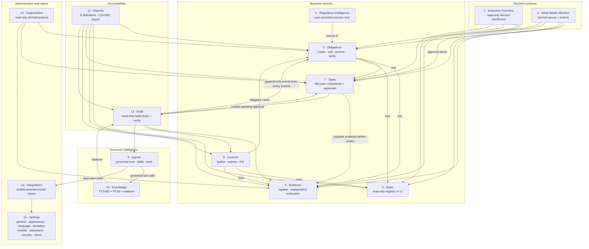

# Diagram 6 — Application Module Map

**Scope:** the 15 navigation modules actually registered in `apps/desktop/src/app/navigation.ts`, and the real read/write relations between their backing services.

## Module status truth table

| # | Module | Status in V1 | Real limits |
|---|---|---|---|
| 1 | Executive Overview | Functional (derived, read-only) | Readiness is a local operational estimate; unmeasured when data is missing. |
| 2 | What Needs Attention | Functional (derived) | Only rules implemented in `attention_service`; no predictive scoring. |
| 3 | Obligations | Functional | Create/edit/archive/human verification; no bulk import. |
| 4 | Regulatory Intelligence | Functional (user-provided) | No live feeds, no official-source verification, no AI interpretation of sources. |
| 5 | Risks | Read-only | Risk authoring and lifecycle transitions are not implemented. |
| 6 | Evidence | Functional | Reference metadata only: no file upload, no PDF ingestion, no OCR. |
| 7 | Tasks | Functional | Lifecycle + transitions + approvals; no scheduler or notifications. |
| 8 | Controls | Functional | Author/assess/link; no automated control testing. |
| 9 | Agents | Functional, governed | Runs require explicit request; no autonomous background execution; tool calling limited to the native Ollama path. |
| 10 | Knowledge | Functional | TXT/Markdown only; lexical FTS5 retrieval; no vector/embedding search. |
| 11 | Reports | Functional | Six local definitions, bounded rows, CSV/Markdown; not a compliance assertion. |
| 12 | Audit | Read-only + verify | Tamper-evident chain with local anchor; not tamper-proof against full device control. |
| 13 | Organization | Read-only | Derived posture; not an editable org-chart system. |
| 14 | Integrations | Read-only status | Shows provider/model truthfully; no cloud connectors, no background sync. |
| 15 | Settings | Functional | Appearance/language/providers/models/data/users/security/about; no policy engine. |

## Arabic summary — ملخّص عربي

يعرض المخطط الوحدات الخمس عشرة الفعلية وعلاقاتها الحقيقية: لوحة تنفيذية وقائمة اهتمام مشتقتان من سجلات الالتزامات والأدلة والمخاطر والمهام والموافقات؛ المصادر التنظيمية يقدّمها المستخدم وتغذّي الالتزامات؛ الالتزامات ترتبط بالأدلة والمهام والمخاطر والضوابط؛ المهام تطلب المراجعة وتنشئ موافقة؛ التقارير تقرأ من الجميع؛ التدقيق يجمع الأحداث من الجميع بلا تعديل؛ المؤسسة عرض مشتق للقراءة فقط؛ التكاملات تعرض حالة المزوّدين بصدق؛ الإعدادات تدير المظهر واللغة والمزوّدين والنماذج والبيانات والمستخدمين. الجدول يعلن حالة كل وحدة وقيودها بدل تسوية الوحدات الشكلية بوحدات مكتملة.
