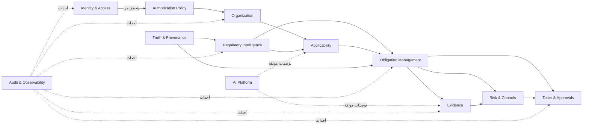

# خريطة المجالات والسياقات — NEXUS

**الحالة:** Baseline 0.1.0  
**الهدف:** ضبط حدود المجال قبل إنشاء الجداول أو خدمات التطبيق.

## السياقات المحددة

| السياق المحدود | نوعه | مسؤوليته الأساسية | التبعيات المسموح بها |
|---|---|---|---|
| Identity & Access | Supporting | هوية المستخدم المحلي، الجلسة، الأدوار، السمات وقرارات التفويض. | Organization، Audit فقط عبر أحداث/واجهات. |
| Organization | Core-supporting | ملف الشركة، الهيكل، الأنشطة، التراخيص، الأنظمة والبيانات. | Identity للوصول؛ Regulatory دون كتابة مباشرة. |
| Regulatory Intelligence | Core | المصادر، الوثائق والإصدارات والمتطلبات والتغييرات ودرجات الثقة. | Truth، Audit، محولات جلب موثقة. |
| Applicability | Core | تقييم انطباق المتطلب على ملف المؤسسة مع تفسير وقابلية مراجعة. | Organization، Regulatory، Truth. |
| Obligation Management | Core | تجميع الالتزامات والملكية والمواعيد والحالة والضوابط والعلاقات. | Applicability، Regulatory، Organization، Audit. |
| Evidence | Core | الدليل، التجزئة، الإصدار، التصنيف، الصلاحية والتحقق والربط. | Obligation، Identity & Access، Audit. |
| Risk & Controls | Core | المخاطر والضوابط وحساب التعرض ومسار المعالجة. | Obligation، Evidence، Task. |
| Work Management | Supporting | المهام والموافقات والإشعارات والتفويض والتصعيد. | Identity، Obligation، Evidence، Risk، Audit. |
| Truth & Provenance | Generic | مصدر الادعاء وثقته وإصداره وحالة تحققه. | يستخدمه Regulatory وObligation وAI. |
| AI Platform | Generic | نماذج ومزودات وسياسات ومخرجات منظمة قابلة للتتبع. | Truth، Authorization، Audit؛ لا يملك المجال الرئيسي. |
| Audit & Observability | Generic | سجل append-only، correlation، قياس محلي وصحة غير حساسة. | يستقبل أحداثاً من كل سياق، ولا يعيد تعديلها. |

## العلاقات التكاملية

## قواعد التعاقد بين المجالات

يُعرّف كل سياق أوامر واستعلامات وأحداثاً مصنفة. لا يُسمح لسياق Evidence مثلاً بتعديل حالة Obligation مباشرة؛ بدلاً من ذلك يرفع حدث `EvidenceVerificationChanged` ويقرر تطبيق Obligation أثره داخل حالة استخدامه. يحظر الاستعلام عبر جداول سياق آخر من مكون واجهة أو مستودع غير مخول.

| قاعدة | تطبيق MVP |
|---|---|
| لا مشاركة لنماذج قاعدة البيانات كواجهات نطاق عامة | تستخدم عقود تطبيق/DTO محددة بين السياقات. |
| لا اعتماد للـDomain على SQLite أو Tauri | تعتمد النواة على traits/mappers ومفاهيم نطاق فقط. |
| مصدر التنظيم منفصل عن التفسير | المصدر قابل للحفظ والتجزئة؛ التفسير يحمل `AI_INTERPRETATION` أو `HUMAN_VERIFIED`. |
| قرار الانطباق غير قرار AI صرف | السياسة والقواعد المنظمة تنتج حالة؛ توصية AI غير ملزمة ومراجعة حيث يلزم. |
| التدقيق لا يُحذف مع الكيان | يحفظ الحدث مع مرجع وhash؛ عمليات الحذف تدقق كحدث مستقل. |

## لغة موحدة مختصرة

| المصطلح | المعنى الدقيق |
|---|---|
| Requirement | نص قابل للإسناد من مصدر/إصدار تنظيمي. |
| Obligation | واجب قابل للتنفيذ يخص مؤسسة محددة ومبني على Requirement وتقييم انطباق. |
| Applicability assessment | نتيجة محددة `APPLIES` أو `DOES_NOT_APPLY` أو `UNCERTAIN` أو `REQUIRES_REVIEW`. |
| Evidence | كائن أو ملف أو مرجع يثبت جزءاً من الوفاء بالتزام ولا يصبح صالحاً إلا بعد تحقق. |
| Truth claim | ادعاء يحمل نوع الحقيقة والدليل والمصدر والثقة وحالة التحقق. |
| Approval | قرار إنساني مسجل ومقيد بنسخة الكائن والسياق والسبب. |
| Tenant scope | سياق غير قابل للإهمال يحدد المستأجر وخصائص الوصول في كل عملية. |

## أحداث المجال الأولية

| الحدث | المنتج | المستهلكون | خاصية الأمان |
|---|---|---|---|
| `OrganizationProfileUpdated` | Organization | Applicability, Audit | يربط actor وtenant ونسخة. |
| `RequirementRegistered` | Regulatory | Obligation, Audit | يتطلب مصدر وإصدار وحالة تحقق. |
| `ApplicabilityAssessed` | Applicability | Obligation, Audit | يرفق سبباً ودرجة ثقة ومراجع. |
| `ObligationCreated` | Obligation | Tasks, Reporting, Audit | لا ينشأ بلا owner وtenant. |
| `EvidenceUploaded` | Evidence | Audit | لا يعني أن الدليل صالح. |
| `EvidenceVerificationChanged` | Evidence | Obligation, Risk, Audit | يربط القرار بمن نفذه. |
| `ApprovalDecided` | Work Management | Originating context, Audit | يثبت النسخة والقرار والسبب. |
| `AgentRunCompleted` | AI Platform | Truth, Audit | لا يطبق تغييرات عالية الأثر تلقائياً. |

## معايير الخروج

هذه الخريطة صالحة للأساس إذا حافظت الحزم والملفات والمهاجرات على هذه الحدود، وإذا لم يحتو التطبيق على خدمة جامعة تمزج قواعد الانطباق والأدلة والصلاحيات والذكاء في كائن واحد.
