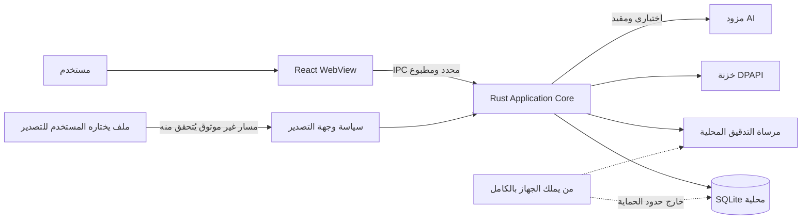

# نموذج التهديد — NEXUS V1

**الحالة:** `0.1.0` · **المنهج:** STRIDE مع تهديدات الذكاء الاصطناعي والمستندات
**حدود التقييم:** تطبيق سطح مكتب Tauri محلي أولاً، SQLite محلية، بيانات `DEMO / SYNTHETIC` في العرض والاختبار.
**موقع هذا المستند:** نموذج تهديد هندسي داخلي، وليس شهادة أمنية ولا إقرار امتثال. الضوابط المذكورة منفَّذة في المصدر الحالي؛ والقيود المتبقية معلنة لا مخفية.

## الأصول الأمنية

| الأصل | التصنيف الافتراضي | سبب الحماية |
|---|---|---|
| سجلات المؤسسة والالتزامات | CONFIDENTIAL | تكشف وضع الجاهزية والمالكين والمواعيد. |
| الأدلة والمستندات | RESTRICTED | قد تحمل بيانات شخصية أو تعاقدية أو أمنية. |
| جلسات وهوية المستخدم | HIGHLY_RESTRICTED | قد تمنح قدرة فعلية على قراءة أو تعديل البيانات. |
| مفاتيح مزوّدات AI والتكاملات | HIGHLY_RESTRICTED | تسمح بالاستخدام أو الإفصاح الخارجي غير المشروع. |
| سجل التدقيق | CONFIDENTIAL | أساس التتبع والتحقيق والنزاهة. |
| مطالبات الحقيقة والمصادر | CONFIDENTIAL | تحدد منشأ قرارات العمل وقابليتها للمراجعة. |

## حدود الثقة

## سجل التهديدات والأولويات

| المعرّف | الفئة | التهديد | الخطر | الضوابط المنفَّذة في V1 | القيد المتبقي |
|---|---|---|---|---|---|
| T-001 | Spoofing | انتحال جلسة مستخدم محلي | عالٍ | جلسة نشطة بعينها تُفحص في كل أمر، `expires_at` و`revoked_at`، Argon2id، قفل تدريجي، إبطال الجلسة عند تغيير كلمة المرور والتعطيل، ورفض هويات الديمو في الإنتاج. | لا MFA؛ من يملك حساب Windows يملك الجهاز. |
| T-002 | Tampering | تعديل SQLite أو سجل التدقيق خارج التطبيق | عالٍ | سلسلة SHA-256 لكل حدث + مرساة محلية (رأس + عدد)، أمر تحقق يعيد الحساب، وكشف التعديل/الحذف/إعادة الترتيب/اقتطاع الذيل. | من يعيد كتابة القاعدة والمرساة معاً لا يُكشف؛ القاعدة غير مشفّرة. |
| T-003 | Repudiation | إنكار تعديل التزام/دليل/موافقة | عالٍ | حدث تدقيق داخل معاملة الكتابة نفسها، بفاعل ومستأجر ومورد وتجزئة سابقة. | مرساة محلية قابلة للاستبدال بتحكم كامل بالجهاز. |
| T-004 | Information Disclosure | تسرب بيانات عبر الواجهة أو خطأ مفصل | عالٍ | IPC مطبوع، `SafeError` مغلق، لا أسرار في السجلات، CSP محلية، وقدرات دنيا. | ثغرة عرض في WebView2 تبقى مسؤولية المنصة. |
| T-005 | Information Disclosure | تسرب بين مستأجرين نتيجة استعلام بلا مرشح | حرج | `tenant_id` إلزامي، مستودعات مفلترة، مشغّلات ترفض نقل الملكية، واختبارات سلبية للعزل. | خطأ جديد في مستودع غير مغطى باختبار يبقى خطراً. |
| T-006 | Elevation | أمر IPC يتيح تشغيل shell أو وصولاً ملفياً عاماً | حرج | لا shell ولا fs عامة؛ القدرات `core:default` و`dialog` فقط؛ تحقق serde وتفويض لكل أمر. | أي قدرة جديدة تُضاف مستقبلاً تحتاج مراجعة أمنية. |
| T-007 | DoS | ملف/تقرير ضخم أو عملية طويلة تحجب الواجهة | متوسط | حدود صفوف التقارير (500/قسم)، حدّ حجم التصدير (8MB)، حدّ طول المسار، ومهلات الشبكة. | لا طابور مهام خلفي؛ العمليات طويلة الأمد قد تُحسّ بالبطء. |
| T-008 | Prompt Injection | مستند أو مخرَج يحاول تغيير سلوك AI | عالٍ | فصل تعليمات النظام عن المحتوى، وسياق مُجمَّع بمصادر، وأدوات مفوَّضة بحدود، وموافقة بشرية للتنفيذ. | لا يُدَّعى أن النموذج غير قابل للتلاعب؛ يبقى الإشراف البشري شرطاً. |
| T-009 | Data Exfiltration | مزوّد AI خارجي يتلقى بيانات مصنفة | عالٍ | لا مزوّد مفعّل افتراضياً، ونداء صريح فقط، وسياسة وجهة، وربط موافقة بهوية الوجهة، وتدقيق. | قرار إرسال البيانات لمزوّد يختاره المستخدم قراره؛ المنتج يوثّقه لا يمنعه. |
| T-010 | Supply Chain | اعتماد npm أو Cargo مخترق | عالٍ | lockfiles ملتزمة، `npm audit` و`cargo audit`، تثبيت `npm ci`، CI، وجرد تراخيص. | التحديثات المستقبلية تحتاج إعادة فحص. |
| T-011 | File Security | ملف متنكر أو مسار traversal | عالٍ | التحقق من امتداد وصيغة التصدير، رفض المسارات النسبية ومجلدات بيانات التطبيق، كتابة ذرّية، وتدقيق. | V1 لا يستورد ملفات أدلة (سجلات مرجعية فقط)، فلا سطح استيراد. |
| T-012 | Over-agency | وكيل ينفّذ تغييراً عالي الأثر دون موافقة | حرج | تفويض أدوات لكل وكيل، حدود مخاطر، موافقة معلّقة، وتدقيق لكل استدعاء. | تنفيذ الأدوات غير المنفَّذة يفشل مغلقاً؛ ولا استقلالية خلفية. |

## قواعد قبول أمنية

لا يُدمج أي مسار ميزات إذا كان يسمح بتجاوز نطاق المستأجر، أو ينفّذ أمراً نظامياً عاماً، أو يكشف سراً في الواجهة أو السجل، أو يحوّل خرج AI أو محتوى غير موثوق إلى تغيير عالي الأثر بلا مراجعة. ولا تُصنّف الحزمة كجاهزة لإنتاج حقيقي حتى تُنفّذ اختبارات العزل وIPC والمستندات والحقن والتنقيح وفق نسخة منفَّذة من هذا النموذج، إضافةً إلى مراجعة أمنية مستقلة.

## خطة الاختبارات الأمنية

| فئة | اختبار سلبي مطلوب |
|---|---|
| Tenant isolation | طلب مورد مستأجر A بسياق B؛ يجب أن يكون الرد `NOT_FOUND` أو `FORBIDDEN` دون تسريب وصف. |
| Authorization | استدعاء تعديل حساس بدور قراءة فقط؛ يجب أن يفشل قبل كتابة قاعدة البيانات. |
| IPC | إدخال حجم غير صحيح أو حقل غير متوقع أو معرف غير صالح؛ يجب أن يفشل تحقق مخطط Rust. |
| Audit integrity | تعديل تسلسل تجزئة تدقيق في نسخة اختبار؛ يجب أن يكشف الفحص عدم النزاهة. |
| Files | محاولة وجهة تصدير نسبية أو داخل بيانات التطبيق أو امتداد مخالف؛ يجب رفضها وتدقيق المحاولة. |
| AI | تمرير محتوى يحاول إعطاء تعليمات؛ يجب الاحتفاظ به كبيانات غير موثوقة وألا يغيّر الأدوات أو السياسات. |

## قيود معلنة

هذا النموذج ليس شهادة أمنية ولا بديلاً عن مراجعة مستقلة واختبار اختراق قبل أي استخدام إنتاجي. تشفير قاعدة بيانات الجهاز، وحماية المحطة الطرفية، وتوقيع الحزمة، والتخزين المؤسسي للمفاتيح، وإدارة الهوية الخارجية (SSO/MFA) تحتاج قرارات وتنفيذاً وتحققاً منفصلاً، ولم تُنفَّذ في V1.
